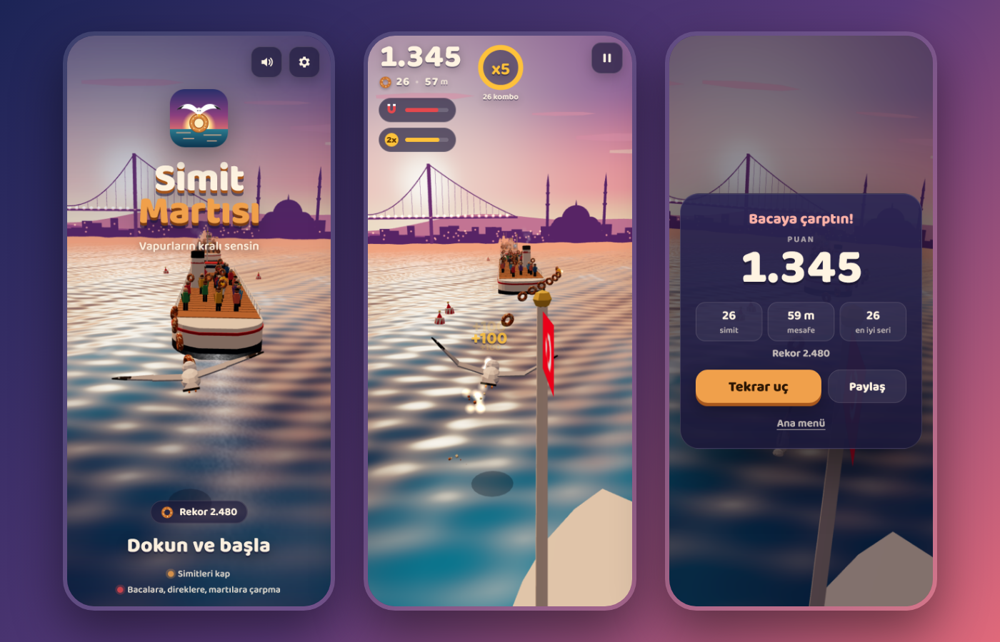

# Simit Martısı

A one-finger 3D endless flyer for phones and desktop browsers.
You are an Istanbul seagull gliding over ferries at sunset, snatching *simit* from passengers' hands
while dodging funnels, flag masts, kites and rival gulls.

**Play:** https://ardazeybek-dev.github.io/simit-martisi/ (installable, works offline after the first visit)



## Controls

| Device | Steer | Other |
|---|---|---|
| Phone | Drag anywhere left / right: the gull moves by how far you drag, never jumps to where you touch, and stays put when you let go; dragging about two thirds of the screen width takes the gull from one rail to the other, pushing past the edge is not counted so turning back starts at once, a second finger never steals the steering, and the slider knob at the bottom shows where you are steering | Pause button top right |
| Desktop | Move the mouse, or ← → / A D | `P` / `Esc` pause, `M` sound on/off, `Space` start |

The game pauses itself when the tab or app goes to the background and resumes with a 3-2-1 countdown.

## Gameplay

- **Goal: fly the Bosphorus line.** Every flight leaves Kadıköy and heads up the strait: Karaköy (400 m), Beşiktaş, Ortaköy, Bebek, Rumeli Hisarı, Emirgan, Sarıyer and the Black Sea (6,800 m). The HUD shows the next pier and the metres left; a pier is a gate with its name board, the terminal on the bank and a simit line ending in a golden simit right under the sign. Flying under the sign triggers a short slow-motion moment with fireworks, then the crowd on the pier throws a shower of simit pieces into the lane; arriving pays bonus points and the flight goes on to the next pier. The first time you reach a pier it pays simits (25 up to 750) and lights up on the title-screen route map; the game-over screen tells you how far the next pier was.
- **Cities:** fly the Bosphorus to the Black Sea and İzmir opens; finish İzmir and Antalya opens. Pick the city with the arrows above the route map on the title screen. Scores are multiplied by the city's `mult` (İstanbul ×1, İzmir ×1.1, Antalya ×1.2; the daily flight ×1). Each city keeps its own pier progress and first-arrival gifts; the wallet, outfits, missions and leaderboard are shared. Each city is harder than the one before (`hard` in `cities.js`): the first 500 m are the same everywhere, then obstacles thicken sooner and the late-game ceiling is higher. Reaching a city's last pier for the first time says *Tebrikler! İzmir açıldı!* (or Antalya) on the pier card and on the game-over screen, and the title screen comes back with the new city picked. Keep the number of piers when changing a route: progress is saved as a pier index.
  - *İzmir:* Üçkuyular to Bostanlı (10,000 m) past Göztepe, Konak, Pasaport, Alsancak, Bayraklı and Karşıyaka, under an Aegean afternoon sky with the Konak clock tower, Kadifekale and the Bayraklı towers on the horizon. You catch gevrek instead of simit (same value). There is no bridge; instead the *imbat* blows: white wind streaks sliding across the water mark a gust lane that pushes the gull downwind while gevreks tumble across it, so leaning with the wind catches them.
  - *Antalya:* Konyaaltı to Kundu (12,500 m) past Kaleiçi, Mermerli, Karaalioğlu, Falez, Lara and Düden, on turquoise water under the snowy Taurus Mountains, with the cliffs, the Yivli Minare and Hıdırlık Tower on the horizon. Three things of its own:
    - *Pirate boat:* a black-sailed tourist gulet slowly crosses the lane. Its masts, sails and tall stern castle are hazards; the gap between the two sails is the way through, and tourists on deck throw simit pieces right into it.
    - *Düden falls:* a waterfall pours off a cliff beside the lane and its spray drifts over that half. Fly into the spray and the gull is lifted up and pushed away from the falls; a high arc of simits with a golden one on top can only be reached by entering the spray at its start.
    - *Beach umbrellas:* a sand spit with straw umbrellas and sunbeds runs beside the lane. Tourists under red, blue and green umbrellas throw pieces in pairs, each ring on the water in its umbrella's colour; catch the same colour pair after pair for a growing streak bonus (two pairs in a row always share a colour, but you have to look ahead to keep it going).
- **Score** = simit points + 1 point per 10 m flown.
- **Lane and hit boxes:** the lane is as wide as a ferry and the gull stays inside the rails, so a glass salon can only be passed through its middle passage and steering is quick, so a late dodge still works. Hazards hit only when you really touch them; rival gulls are clearly smaller than yours. Simits and power-up bubbles are picked up from a generous distance around the gull.
- **Combo:** catch simits in a row to raise the multiplier; x2 at 10, x3 at 25, x4 at 45, x5 at 70 simits in a row. The chain dies when you let a simit in your own path pass (simits in another lane do not count), a thrown piece drop into the sea, or go about 2.5 s without a catch; simits held by passengers do not count as missed. The ring in the HUD shows how long it stays alive. From x2 on, thin trails stream from the gull's wing tips, growing a little stronger and turning a soft cream gold toward x5 (white on the golden gull); they fade as the chain is about to die, so you can tell without looking at the HUD.
- **Simit boats:** on open water, simit sellers in rowboats on both banks break their simits and toss the pieces to you. Each piece is a quarter simit (a quarter of the points and of the wallet value); some throwers toss a single piece, others up to four; it arcs over and comes down right as you get there, with no mark on the water beforehand (only the beach shows coloured rings for its colour streak); miss it and it splashes into the sea. On ferries and at piers the thrower is often the simit seller himself, next to his glass-cased cart or his tray with a simit pole: the simits on display are scenery and can't be eaten, only the pieces he throws can.
- **Ferries:** three kinds share the lane width: the classic line ferry (44-58 m, round stern, red band), the short motor ferry (34-38 m, square stern, portholes, blue band, low raked funnel, never a glass salon) and the big ferry (60-64 m, two rows of windows, gold line, bridge wings, lifeboats hanging outside the rails, a wide funnel). Each funnel's hit box matches its shape.
- **Golden simit:** rare (only every other turn has one at its apex; the pier gate and the waterfall top always do), worth 5x a normal one; it glints like a star from far away, so you can line up for it early. Golden pieces are never thrown by the simit sellers: they hang still at their catch point and spin and shine in place.
- **Dolphins:** on open water a pod shows its fins, then leaps across the lane one after another as you arrive. Fly over a dolphin while it is in the air (within about 2.4 m sideways; the crossing is checked even if a frame skips past it) for a *Dolphin!* bonus that also refreshes your combo timer. They never hurt you.
- **Near miss:** brushing past a funnel or mast gives a small bonus.
- **Turns:** the Bosphorus bends every 15-25 seconds, sometimes in an S. Red chevron boards and a *VİRAJ* sign warn you first. Inside a turn the wind pushes the gull outward, so lean toward the inside: the simits trace the racing line with a golden one at the apex. Catch most of the line for a *Perfect turn* bonus and a slingshot burst of speed.
- **Power-ups** (floating bubbles): Magnet pulls simits (even out of passengers' hands), Shield absorbs one hit, 2x doubles all points.
  Upgrade them with simits in the *Güçlendir* panel: five levels each (600 up to 9,000 simits a level), every level adds a quarter of the base time.
- **Hazards:** funnels, flag masts, kites, rival gulls. A stretch of open water with a crossing sailboat has no rivals or kites, and elsewhere rivals and kites are at least 13 m apart, so there is always a way through. Turns are short (48-70 m) and from the second difficulty step on carry a rival or kite 2.6 m off the simit line; every pier after the first has a welcome party in its simit rain (a rival, then a kite, more in later districts). Dark funnel smoke makes the gull cough and blurs the edges of the screen for a moment; it does not break your combo.
  - Hazards stay sparse early on: rival gulls come one at a time from about 200 m, red ones after Karaköy, blue ones after Beşiktaş; the first Galata Bridge comes after Karaköy.
  - Rival colour tells you how it flies: *grey* glides side to side, *red* dives straight at you from further out, *blue* zigzags at random.
- **Passengers:** big-headed, round-eyed and rosy-cheeked; uncles, grandpas, aunties, young women and lads, each with their own outfit; snatch a simit and they get angry. The decks are kept sparse: most of the few who stand hold a simit (snatch it, they get angry); a handful sit on benches looking out to sea with a glass of tea and no simit. A *feeder* at the rail holds a simit out for you: take it and they cheer and pay a bonus. On some ferries a passenger at the rail breaks their simit and throws the pieces into the air over the deck, like the simit boats do; a ring on the deck marks where each piece comes down.
- **Galata Bridge:** every 1-1.5 km the lane passes under the bridge. Anglers on both rails dangle their lines down to the water at uneven gaps (a red float marks each one); thread between them, front row then back row, following the simits. Touch a line and you are hooked. Clear both rows for an *Under the bridge!* bonus.
- **Deck props:** when you come near a green rubbish bin its lid pops and a simit piece jumps up to your height; crates with a cat that hisses as you pass; rope coils.
- **Glass salon ferries:** further on, some ferries carry a closed two-storey glass salon. Fly through the open passage in the middle and collect the simits inside; the glass on either side is solid.
- **Weather follows the real calendar** (picked again every flight): snow in winter, mostly rain in autumn, now and then fog, mostly clear in spring and summer.
  - *Rain:* lightning, and gusts of wind shove the gull sideways; steer against them.
  - *Hunger (any weather but snow):* a fullness bar (AÇLIK) stays on screen the whole flight and drains after the first 50 m. With no simits it runs out in 6 s (İzmir 5.5 s, Antalya 5 s); a simit refills 25%, a golden one 60% (a thrown piece half that), so you have to keep catching. When it runs out the combo resets, the gull's head droops and it steers sluggishly until it eats two simits. The longest gap between simits on the route is about 2-3 s.
  - *Snow:* a warmth meter drains while you fly. Simits warm you up (a golden one a lot); it stays on screen the whole flight and with no simits runs out in 6 s (a simit warms 25%, a golden one 60%). Frozen, you lose your combo and the gull shivers, droops and steers sluggishly until simits warm it back to 30%. It starts draining after the first 50 m.
  - *Fog:* the view shortens, hazards appear late, ferry horns sound through the mist.
- **Speeding up:** the further you fly, the faster it gets: steep in the first minute, then creeping up to a top speed. On top of that, tempo stretches planned by distance (the same for everyone in the daily flight): *calm water* (about 13% slower, no rivals or kites, a simit rain or two dolphin pods) and *tailwind* (about 14% faster, heavy speed lines, a whoosh on entry); the speed eases in over about 2.5 s so thrown simits still land on time.
- **Varied route:** open water and ferries no longer strictly alternate: sometimes two ferries come as a convoy (a short simit-only gap between them), sometimes two stretches of open water in a row. Each stretch of open water is one kind, never the same special kind twice in a row: mixed, simit rain, dolphin pods, a rival flock or a kite row. After about 1.6 km the lane does not get more crowded but smarter: more red and blue rivals, red ones dive a little faster, open water gets shorter; rivals start moving earlier at high speed so there is still time to react.
- **Second chance:** spend fish to keep flying from where you crashed, with a shield and a 3-2-1 countdown. Each revive in the same flight costs twice the last one (1, 2, 4... fish); the button shows up once you own a fish. On the portal build a rewarded ad also gives one revive per flight after a good run (250+ points and at least 40% of your best).
- **Simit wallet:** ten simits you catch (or 40 thrown pieces) put one simit in the wallet, and every 100 m flown adds one more (a golden one counts as 4 caught); the remainder carries over to the next flight (shown as *sonraki n/10* on the game-over screen), so outfits (200 to 5,000) and power-up levels (600 to 9,000) take a while to earn; the game-over screen just counts up the simits this flight earned. Spend them on outfits in the *Kostümler* panel: fez, beanie, captain hat, golden crown, simit seller's tray, chef hat, giant top hat, simit crown, sunglasses, heart glasses, giant glasses, scarf, bow tie, evil-eye bead, moustache, baby pacifier, and pink, mint, night, sunset, ice or golden feathers, the courier gull (green, helmet, delivery bag on the back; mission rewards +15%), the taxi gull (yellow with checker stripes and a roof light; close-call points x2), or the dürüm gull (wrapped in lavash with lettuce wings, meat, tomato and lemon at the front and sauce on the back). The gull stands on a wooden pier post against a Bosphorus sunset and turns slowly; drag anywhere outside the panel to spin it by hand. Six outfits also have a perk (marked ★, shown when tapped; only a worn, owned item counts, a preview does not): golden crown +40% golden simits, simit crown +15% catch reach, giant top hat power-ups last 20% longer, evil-eye bead shields show up more often, scarf freezes 40% slower in snow, golden gull +10% simits to the wallet. Tapping an item previews it on the gull; a separate button buys, wears or takes it off. Head, eyes, neck, face and feathers each take one item. The panel has three tabs: *Kıyafet* (eyes, neck, face), *Deri* (feathers) and *Şapka* (head). Every day one outfit you do not own is 20% off (*deal of the day*), picked from the date alone so it stays the same all day and changes at midnight; there are no other discounts. Outfits are drawn oversized, and the feather outfits add their own back and tail pieces (ice crystals and icicles, golden spikes and plumes, a crescent and stars, a flamingo tail fan, mint leaves, a sunset tail) so they read from the chase camera behind the gull. The game-over screen shows how many points you were short of your record and a bar toward the cheapest outfit you do not own yet.
- **Outfit perks:** one item per slot (hat, eyes, neck, face, skin), and items from different slots are worn together, so their perks stack. Every outfit has a small perk (★ in the panel): hats — fez simit points +3%, beanie colds 20% slower in snow, chef tea break +15%, captain magnet +15%, top hat all power-ups +10%, tray mission rewards +5%, golden crown golden simits +20%, simit crown catch reach +8%; eyes — sunglasses shield +15%, heart glasses combo timer +5%, giant glasses fish catch +5%; face — moustache close-call points +25% (not stacked with the taxi), pacifier shield after a revive +25%; neck — scarf colds 40% slower, bow tie dolphin bonus +50%, evil-eye bead one more shield in the power-up pool; skins — pink simit points +5%, night rain wind pushes 20% less, mint no cough from funnel smoke, sunset distance pays 15% more simits, ice colds 50% slower in snow, dürüm fish jump 15% more often, golden wallet +10%, courier mission rewards +15%, taxi close-call points x2. Score perks stay small on purpose: the leaderboard must not be bought.
- **Power-ups** show on about a third of open-water stretches, never the same kind twice in a row.
- **Fish:** the second currency. Fish are rare: at most one fish per flight, never in the first 700 m, and only now and then (`fishSpawn` 12% per stretch of open water, +5% for every stretch that passed without one, so long flights almost always get a chance) does one splash on open water and leap up to the gull's height as you arrive. Touch it and you may catch it (`fishCatch` 75%: a fish for the wallet, a small bonus, a fresh combo timer and a *Balık!* bubble) or it slips away (*Kaçtı!*). At most 2 fish a day from flights (a first revive costs 1 fish, a second one in the same flight 2 more, so a double revive takes saving up): the count is kept on the server per player id and Istanbul day (RPC `fish_day`), with a local fallback offline. Fish pay for revives; the 7th day of the daily reward streak also gives one.
- **Leaving a flight:** a flight is saved every 10 s and whenever the page is hidden or closed (score as pending for the leaderboard, simits banked, record, achievement counters and missions), so a reload or crash loses nothing. *Ana menü* in the pause menu ends the flight on the game-over screen (*Uçuş bitti*), so the score still reaches the leaderboard and the simits the wallet; if the page is hidden, reloaded or closed mid-flight, the score so far is kept as pending and sent on the next launch (the run ticket is valid for a day).
- **Title screen:** tapping outside an open panel closes it (it never starts a flight). The wallet and record sit on top, the side buttons open outfits, missions, rewards, achievements, the board and power-ups; the bottom row is a mode button (Classic or Daily flight, picked from a card list where later modes go) next to Play, which starts the picked mode. The name and the gull rank live in Settings → Profile. Outfits are tried on a lit podium where the gull turns in place instead of over the water.
- **Daily flight (picked with the mode button):** every day everyone flies the same İstanbul route with one rule of the day, picked from the date: *Golden hour* (golden simits twice as often, one at every turn's apex), *Fast ferries* (15% faster), *Chubby gull* (a fat-bodied, bigger gull that steers sluggishly but grabs simits from further away; obstacles hit a little sooner), *Giant simits* (simits twice the size, each counting as two) or *Hiccuping gull* (every 2-4.5 s the gull hiccups: it hops sideways and puffs up for a moment). Try one with `?rule=gold|fast|chubby|giant|hiccup`. Three tries a day (`DAY_RUNS`): a try is used on take-off, so quitting mid-flight still counts, while a second chance does not; the mode button shows the tries left and Play greys out when they are gone. The route is seeded from the date: world generation reseeds for every segment and every turn (`seedAt` in `main.js`), so a segment changed by the player (rivals sent to a camped edge) does not shift the ones after it. The rule shows once on the take-off card. Daily flights keep their own best for the day and a day streak; the first finished daily flight each day pays 15 simits, growing by 5 a day up to 45. They do not touch your record or friend challenges (the share link carries no challenge), but they count for the weekly leaderboard like any flight.
- **Gull rank:** every flight turns into XP (1 per simit caught, 1 per 20 m); level *n* needs 80 + 40·*n* XP and each new level pays 5 + *n* simits (up to 30). Titles change at levels 1, 3, 6, 10, 15, 20 and 30 (Gull chick, Ferry gull, Simit hunter, Bosphorus wolf, Pier boss, Captain gull, Legendary gull). Settings → Profile shows the level badge, the game-over screen fills the XP bar; nothing shows during a flight. Tune `xpNeed`, `lvGift` and `RANKS` in `main.js`.
- **Rewards panel (*Günlük ödül* button):** two tabs. *Daily reward* grows with the login streak (10 up to 80 simits, a fish on day 7). The server keeps the claim (Supabase RPC `daily`, keyed by a hash of the network address and browser), so clearing the device's data does not give the reward twice or reset the streak; the day turns over at midnight Istanbul time. Without a connection the local record is used. *Lucky wheel* spins for 1 fish or 300 simits; eight slices pay 100, 150, 250, 500, 1,000 or 3,000 simits, or 1 or 3 fish (the jackpot comes up about once in 50 spins, and on average the wheel pays back less than it costs). The prize goes into the wallet as soon as you spin, so closing the panel mid-spin loses nothing. Tune it with `WHEEL`, `SPIN_FISH` and `SPIN_SIMIT` in `main.js`. The wheel also gives one free spin a day (the menu dot shows it is waiting); it only lands on 100 simits (97%) or 1 fish (3%), never on the paid wheel's big prizes (`FREE_W`). If you missed one or two days of the login streak (and it was on day 2 to 6; after day 7 it starts over anyway), *Save the streak* buys it back for 50 simits.
- **Challenge a friend:** the share button on the game-over screen sends a link carrying your score and distance (on phones together with a 1080x1080 picture of the flight). Whoever opens it sees *A friend scored N* on the title screen, and in that city a blue flag buoy with your score floats beside the lane at the metre where you crashed; flying past it pays a small bonus. The game-over screen tells them how many points are missing or that they won, and the button turns into *Ask for a rematch*. A challenge stays until it is beaten; a new link replaces it.
- **Record buoy:** a golden flag buoy marks your longest flight so far (from 150 m on); passing it chimes.
- **Leaderboard:** a real, permanent table shared by every player (it never resets). Every flight counts from the very first one: a player with no name yet is registered as "Martı" plus four digits, and after the first flight the game asks for a gull name (2-16 characters, changeable from Settings → Profile or from the board); picking one renames the same entry. Each flight sends its score, including the part flown after a second chance; the board ranks everyone by their best score ever. The first time a device syncs, its local record (made before the board existed or offline) is sent once, capped at 30,000. The game-over screen shows your rank and how far you climbed; the board lists the top 50, your own row and how many points the player above you is ahead. Offline the game plays as usual; a flight that started online but ended offline is sent when the connection is back, a flight started offline stays off the board; "Invite friends" shares the game link.
- **Missions:** come in sets of three ("catch 45 simits in one flight", "8 close calls", "fly under the bridge twice"...). A finished mission pays simits right away; when all three are done the next set arrives once you have seen them finish in the *Görevler* panel, about 22% harder and paying about 10% more each set (capped at what one flight allows). At most three sets a day; a new day also replaces a set you got stuck on. The game-over screen stays uncluttered (no record, rank, distance-to-next-pier or next-outfit lines, and the share button just says *Paylaş*): open *Görevler* from the title screen to watch the bars fill up from where the flight started, finished missions get crossed out and their simits tick up into the wallet. The menu badge counts new missions and clears once you open the panel.
- **Achievements:** twelve long-term goals (total simits, golden simits, longest flight, best score, streak, snatched simits, close calls, perfect turns, dolphins, bridges, flights, outfits), each with bronze, silver and gold tiers paying 25 / 75 / 200 simits, claimed in the *Başarımlar* panel. Your earlier best score and furthest pier count from the start.
- **Badges:** a collection tab in the *Başarımlar* panel with 21 badges and no rewards: total distance (1 km up to 10,000 km), days in a row (3 up to 365), flights, fish, simits, finished cities, and a 500 m flight in rain, snow and fog. Newly earned badges glow and are counted on the menu button until you look; tap a badge to see how to earn it.
- **Quiet screen:** no floating score texts during a flight; bonuses, missions and power-ups land silently in the score and the wallet. Only the *VİRAJ* sign, the pier arrival card, the passengers' short speech bubbles (when you snatch their simit, at most one every couple of seconds) and *Balık!* / *Kaçtı!* when you touch a fish appear. Passengers say something different every time: about 130 lines by passenger type (uncle, grandpa, auntie, young woman, lad, child) plus shared ones, and no line repeats within a flight.
- **Languages:** 20 (Turkish, English, German, Spanish built in, 16 more in `js/lang/`). The browser language is used when supported, otherwise English; *Settings* has a drop-down listing each language by its own name.
- **Settings:** music and sound effects volume sliders, the same in the title settings and the pause menu; tapping the speaker next to a slider mutes it, tapping again puts the slider back where it was. Vibration and language (Turkish, English, German or Spanish, the browser language by default). The title screen has no separate sound button; *M* mutes on a keyboard.
- **Title screen:** the camera sits at the gull's eye level and the chosen city stands right behind it in three smooth-shaded layers (front, middle, back) that drift at different speeds with the camera's slow sway (İstanbul: Galata Tower over its hillside, a mosque, the quay with a docked ferry, the Maiden's Tower with waving visitors in front; İzmir: the Kordon palms, the clock tower, Yalı mosque, the Asansör, Kadifekale and the Bayraklı towers; Antalya: Kaleiçi harbour with gulets and a pirate boat, Konyaaltı umbrellas, the cliffs with Yivli Minare, Hıdırlık Tower and Düden falls, the snowy Taurus behind). It is hidden as soon as the flight starts.
- **Off-lane scenery:** the flight horizon is shaded for depth, with a second skyline row behind the first and a haze band along the waterline.
- First launch shows a 3-second swipe tutorial; best score, settings, wallet, outfits and missions are kept in `localStorage`.

## Tech

- Plain ES modules under `docs/`, no build step; [three.js](https://threejs.org/) 0.160 from jsDelivr via an import map
- All models are generated in code and merged into vertex-coloured meshes. Every visible mesh drawn with the shared vertex-colour or gold material is drawn through one InstancedMesh per geometry (`syncBatches` in `models.js`): the objects keep living in the scene for gameplay but sit on a camera-hidden layer, and each frame their world matrices are copied into the batches (frustum-culled, mirrored meshes excluded). A busy frame went from about 300 to about 110 draw calls, which was what made phones stutter
- Soft pastel sunset sky over clear turquoise water, custom GPU wave shader with fresnel and sun glitter (waves calm down with distance into a hazy far sea), gradient sky dome, a colourful Istanbul skyline (pastel houses with tiled roofs, cream mosques with lead domes, Galata Tower with its dark cone, Bosphorus Bridge, Maiden's Tower, green hills, ships with coloured hulls and containers) that fades into the haze with distance and in bad weather
- Off-lane scenery: ferries, container ships and tankers cruising past in the outer lanes, big cargo ships and tankers lying at anchor in the haze further out, parallel to the lane so they never poke into the shipping lanes, ship silhouettes (cargo, tanker, ferry, cruise ship) drifting along the horizon in evenly spaced rows and on the side horizons, never overlapping and only wrapping around while off screen, flocks of gulls in V formation high in the sky (one instanced mesh, never in your way), anchored fishing boats, sailboats and small yachts whose crews jump and wave as you pass, orange lifebuoys on the hulls, a big cruise ship with a jumping crowd on its top deck and terraces (instanced, a few draw calls), and every 1-2 km a close pass by the Maiden's Tower: a rocky islet with a railed terrace of waving visitors, striped umbrellas, a simit cart, a small lighthouse and a wooden jetty with a moored boat (never on the same bank as a nearby cruise ship)
- Pooled instanced particles, smoke sprites, speed lines, camera shake, hit-stop
- Music and all sound effects are synthesized with the Web Audio API, no audio files: a Hicaz tune with plucked saz strings (Karplus-Strong), kanun tremolo, a ney in the middle section and darbuka in maqsum rhythm; cymbals and fills join in as the flight speeds up
- Adaptive quality: pixel ratio steps down automatically on slow devices; turning shadows off recompiles every shader, so that switch waits for the menu or the game-over screen instead of freezing a flight. Phones start at medium quality with MSAA (cheap on tile-based phone GPUs) and without shadow maps (the gull keeps its blob shadow); their lowest pixel ratio is 1.5 so fast turns never look pixelated, and the audio uses a larger buffer, a longer scheduling window and pre-built saz strings. The audio graph is built while the title screen idles (the context starts suspended) and the first tap only resumes it; building it on that tap froze the take-off frame for about 150 ms
- PWA: web app manifest + service worker (network-first for game files, cache-first for the pinned three.js build)

## Run locally

Serve the `docs/` folder over HTTP (ES modules do not load from `file://`):

```
python serve.py
```

Then open http://localhost:8765. An internet connection is needed the first time to load three.js and the font.
`serve.py` sends `Cache-Control: no-store`; a plain `python -m http.server` sends no cache headers, so the browser can keep old modules after an edit and you test an older build without noticing. The service worker only registers on https.

These test addresses work only on localhost (`QS` in `main.js`, `FORCE` in `weather.js`); on the live site they are ignored so a locked city or short route cannot be opened from a link. `?stop=0.02` puts the piers even closer than `?stop`. Append `?turn=0` to fly a straight Bosphorus without turns, `?throw=0` for the old floating simits instead of thrown ones, or `?pal=old` for the earlier deep sunset colours, `?weather=rain|snow|fog|clear` to force the weather, `?bridge` to meet the Galata Bridge right away, `?imbat`, `?pirate`, `?duden` or `?beach` to meet that city feature right away, `?salon` to give every ferry a glass salon, `?stop` to put the piers very close together (handy for comparing), `?rule=gold|wind|fog|fast|fish` to force the daily flight's rule of the day.

Append `?q=0`, `?q=1` or `?q=2` to the URL to lock the quality level (low / medium / high) and turn off automatic adjustment.

No environment variables are needed: the leaderboard backend address and its publishable key sit in `docs/js/net.js` (`SB_URL`, `SB_KEY`).

## Leaderboard backend (Supabase)

A free Supabase project holds three tables, `players`, `scores` and `runs`. All are closed to the client (RLS on, no policies, privileges revoked); the game only calls these `security definer` functions over `POST /rest/v1/rpc/<name>` with the publishable key:

| function | does |
|---|---|
| `register(p_name, p_cc)` | creates a player, returns `{ id, secret, name }` (kept in localStorage `simit-martisi-profile`) |
| `rename(p_id, p_secret, p_name)` | changes the name |
| `set_cc(p_id, p_secret, p_cc)` | changes the country (flag), picked in the profile from the drawn flags in `board.js` (`COUNTRIES`) |
| `start_run(p_id, p_secret)` | called when a flight starts, returns a run id (one per 2 s per player) |
| `submit_score(p_id, p_secret, p_run, p_score, p_dist, p_city)` | keeps the best (stored per week), returns the all-time rank |
| `claim_best(p_id, p_secret, p_score)` | once per player: stores the device record (≤ 30,000) |
| `claim_gifts(p_id, p_secret)` | once per page load: returns the total of the player's unclaimed gift simits and marks them claimed; the game adds it to the wallet and shows *Hediye geldi* on the title screen |
| `get_board(p_id)` | `{ total, top[50], me }` ranked by each player's best ever (`week`, `ends`, `prev` stay null for old clients) |

To give a player simits: find the id with `select id, name from players where name ilike '%name%'`, then `insert into gifts(player_id, amount) values ('<id>', 5000);` in the SQL Editor. The player gets them the next time the game opens.

Cheat and name guards (server side, so a hand-made request cannot skip them):
- A score is checked against the seconds `t` since its run started: distance ≤ 40·t + 100 m (top speed with the sling is about 29 m/s) and, after dividing the score by the city multiplier (İzmir 1.1, Antalya 1.2), score minus distance/10 ≤ 600·t + 1500 and ≤ 12·distance + 1500 (real flights top out near 6.7 points per metre). An invincible autopilot averages about 90 points/s, but the 2x power-up with a x5 combo pushes real flights past 200/s, so keep the cap well above that. A flight started offline has no run id and stays out of the board (it still counts for the local record).
- Names: 2-16 characters, and a blocklist (Turkish, English, German, Spanish) checked after folding `ı→i`, `0→o`, `@→a`, dropping non-letters and repeated letters, so `0r0spu` or `F.U.C.K` are caught. The same list and folding live in `docs/js/net.js` (`BAD`, `norm`) to warn the player at once; change both together.

To set up a new project: run `supabase/schema.sql` in the SQL Editor (it can be run again after edits; existing data stays), then put the project URL and the publishable key into `docs/js/net.js`. The secret / service_role key never goes into the client or the repo.

- A function added to `schema.sql` does nothing until the file is run again in the SQL Editor: the client treats the missing-function 404 (`PGRST202`) as a rejection and keeps retrying silently (the country picker never reached the server this way) → after each schema edit, call every RPC with curl and a dummy id; `unknown player` means it exists.

- A free project that gets no requests for about a week is paused by Supabase → `.github/workflows/keepalive.yml` calls `get_board` once a day. GitHub turns scheduled workflows off after 60 days without commits; if the board ever says "No connection" for everyone, restore the project from the dashboard and re-enable the workflow.
- To remove a cheating or rude player: `delete from players where id = '...';` in the SQL Editor (their scores and runs go with it).

## Portal build (CrazyGames)

`platform/build.py` writes a portal copy to `platform/crazygames/` without touching `docs/`:

```
python platform/build.py                 # platform/crazygames/
python platform/build.py --zip <out_dir> # also simit-seagull-crazygames.zip, index.html at the zip root
python platform/covers.py <out_dir>      # 1920x1080, 800x1200 and 800x800 covers (needs Playwright)
```

The portal copy:
- loads three.js and the Baloo 2 font from `platform/vendor/` (portals reject absolute URLs),
- drops the service worker, manifest, social meta tags, the share button and the leaderboard (no outside requests: `net.js` gets an empty backend address, the board button is hidden),
- calls the CrazyGames SDK v3: loading and gameplay events, `happytime` on a new best, a rewarded ad for the second chance (granted only on `adFinished`; on error the player sees "No ad available"), a midgame ad on "play again" after 60 s of play (never on the title screen: no ads behind menu buttons; skipped when a second chance was just offered), audio muted during ads and when the portal asks for it.

Without the SDK (ad blocker, local run) every portal call is a no-op and the game plays normally.
`?pf_minplay=0` shows the ad break on the first restart, for testing.

The build patches `docs/` source by exact string match and stops with `patch '<name>': expected 1 match` when the game code changed. Update the matching line in `build.py` then.
New game features need no new patch: call portal functions as `window.PF && PF.x ? ... : fallback`, never declare `PF` or `T` in `main.js` (the build injects them), and wrap new texts in `tr()` and add them to the `EN` table in `docs/js/i18n.js` (shared by both builds; static HTML texts are translated once at load).

## Project structure

```
docs/
  index.html            markup, meta tags, import map
  style.css             UI (HUD, screens, animations)
  js/i18n.js            language table and translation (classic script, loads before main.js)
  js/lang/<code>.js     the other 16 languages (fr it pt nl pl ro az id vi el ru uk hi ja ko zh); only the chosen one is loaded
  js/main.js            game state, input, spawning, collisions, main loop
  js/scene.js           renderer, camera, lights, sky, per-city skyline and colours, water shader
  js/models.js          seagull, outfits, simit, passengers, ferry types, Maiden's Tower, simit carts, kite, power-ups
  js/fx.js              particles, sparkles, smoke, speed lines, floating texts
  js/shiplights.js      ship lights (windows, masthead, sidelights) as one weather-dependent Points draw
  js/audio.js           synthesized music and sound effects
  js/cities.js          cities: pier lines, save keys, pickup type and city-only features (bridges, imbat, pirate boat, falls, beach)
  js/board.js           flags, local weekly best
  js/net.js             leaderboard client: name, score submit, board fetch (Supabase RPC, 5 s timeout, offline-safe)
  js/util.js            helpers, mesh merging, safe localStorage
  sw.js                 service worker (bump VERSION on every release)
  manifest.webmanifest  PWA manifest
  icons/                app icons (SVG source + rendered PNGs)
  og.png, preview.png   social preview and README image
serve.py                no-cache local server for docs/
supabase/schema.sql     leaderboard tables, RPC functions, cheat and name guards
.github/workflows/      keepalive.yml: daily request so the free Supabase project is not paused
platform/
  build.py              portal copy of docs/ (see above)
  covers.py             cover images rendered from the title scene
  src/platform.js       portal adapter: SDK calls, ad breaks
  vendor/               three.module.min.js r160, Baloo 2 woff2 + OFL licence
```

## Pitfalls

- `renderer.info.memory.geometries` keeps climbing during long runs when spawns build new geometry/materials (removing from the scene does not free GPU buffers) → cache them per variant (ferry type and length, gull type, passenger look, decor per city bait) and reuse. Cache builders that draw random numbers only on a miss shift a seeded route (the daily flight differed between the first and later flights) → builders run on the native RNG (`pureCall` in `models.js`).
- Script order breaks loading: a `<link rel="modulepreload">` before the import map makes Firefox ignore the map ("bare specifier" error), and the CrazyGames SDK initialised from `<head>` throws `Cannot read properties of null (reading 'appendChild')` → import map first, SDK and adapter at the end of `<body>`; paths must stay relative (`./`, `sw.js`, `icons/...`) since Pages serves from `/simit-martisi/`.
- Geometry and colour traps: touching `ShapeGeometry` pieces on far scenery (a snow cap on a ridge) never draw → earcut can't triangulate zero-area edges, so build those quads as plain `BufferGeometry`; merged geometry coloured per triangle by height gives zebra stripes on tall faces → build each colour band as its own extrusion; a colour mixed in by hand after `fog_fragment` in a ShaderMaterial comes out dark and salmon (it is linear, the output is sRGB) → wrap it in `linearToOutputTexel`.
- Headless browsers render WebGL with SwiftShader at a low frame rate, so quality drops to the lowest level and gameplay runs in slow motion; Playwright WebKit on Windows also stops showing the canvas after any canvas resize → test WebKit with `?q=1`. A sideways finger drag inside a scrollable `.modal` fires `pointercancel` (`touch-action` resets at scroll containers) → give such a modal `touch-action: none` and test drags with CDP `Input.dispatchTouchEvent`.
- Shader traps: bending the world in eye space with a downward-pitched camera lifts far water above the skyline in turns → bend in a level frame (`uLevel`, camera pitch and roll removed); toggling shadows recompiles every material (seconds of freeze on phones) → never toggle mid-flight; `sin()` of world coordinates in the thousands turns the water grainy on phone GPUs far along the route → feed local coordinates (`uOrigin`) and phases wrapped to 2π on the CPU. A transparent `DoubleSide` material is drawn in two passes that each set `needsUpdate`, so three.js re-picks its shader every frame → give it `forceSinglePass: true`. Points or meshes drawn with your own `ShaderMaterial` float off their ships in turns, because the world bend lives in `project_vertex` behind `USE_FOG` → set `fog: true`, merge `UniformsLib.fog` and use `#include <project_vertex>`.
