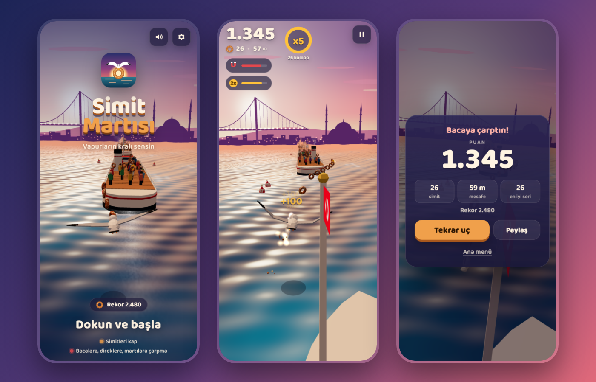

# Simit Martısı

A one-finger 3D endless flyer for phones and desktop browsers.
You are an Istanbul seagull gliding over ferries at sunset, snatching *simit* from passengers' hands
while dodging funnels, flag masts, kites and rival gulls.

**Play:** https://ardazeybek-dev.github.io/simit-martisi/ (installable, works offline after the first visit)



## Controls

| Device | Steer | Other |
|---|---|---|
| Phone | Slide your finger left / right (the middle 80% of the screen covers the whole lane) | Pause button top right |
| Desktop | Move the mouse, or ← → / A D | `P` / `Esc` pause, `M` sound on/off, `Space` start |

The game pauses itself when the tab or app goes to the background and resumes with a 3-2-1 countdown.

## Gameplay

- **Score** = simit points + 1 point per 10 m flown.
- **Combo:** catch simits in a row to raise the multiplier (x2 at 4, up to x5). The ring in the HUD shows how long the chain stays alive.
- **Simit boats:** on open water, simit sellers in rowboats on both banks break their simits and toss the pieces to you. Each piece arcs over and comes down where a ripple ring marks the water, right as you get there; miss it and it splashes into the sea.
- **Golden simit:** rare, worth 5x a normal one.
- **Near miss:** brushing past a funnel or mast gives a small bonus.
- **Turns:** the Bosphorus bends every 15-25 seconds, sometimes in an S. Red chevron boards and a *VİRAJ* sign warn you first. Inside a turn the wind pushes the gull outward, so lean toward the inside: the simits trace the racing line with a golden one at the apex. Catch most of the line for a *Perfect turn* bonus and a slingshot burst of speed.
- **Power-ups** (floating bubbles): Magnet pulls simits (even out of passengers' hands), Shield absorbs one hit, 2x doubles all points.
- **Hazards:** funnels, flag masts, rival gulls, kites. Dark funnel smoke does not kill you but breaks your combo.
- **Weather follows the real calendar** (picked again every flight): snow in winter, mostly rain in autumn, now and then fog, mostly clear in spring and summer.
  - *Rain:* lightning, and gusts of wind (*Gust!* with an arrow) shove the gull sideways; steer against them.
  - *Snow:* a warmth meter drains while you fly. Simits warm you up (a golden one a lot); let it run out and you freeze, losing your combo.
  - *Fog:* the view shortens, hazards appear late, ferry horns sound through the mist.
- **Speeding up:** the further you fly, the faster it gets. A *Speed up!* call every 300 m; the climb is steep in the first minute and keeps creeping up until a top speed.
- **Second chance:** after a good run (250+ points and at least 40% of your best) the game-over screen offers one revive per run. You continue from where you crashed with a shield and a 3-2-1 countdown. Free on the web version, a rewarded ad on the portal build.
- **Simit wallet:** every simit you catch is banked (a golden one counts as 5). Spend them on outfits in the *Kostümler* panel on the title screen: fez, sunglasses, scarf, captain hat, golden crown. Head, eyes and neck each take one item.
- **Missions:** three at a time ("catch 30 simits in one flight", "5 close calls", "fly 5 times"...). A finished mission pays simits on the spot and is replaced at the start of the next flight. Progress shows on the game-over screen.
- First launch shows a 3-second swipe tutorial; best score, settings, wallet, outfits and missions are kept in `localStorage`.

## Tech

- Plain ES modules under `docs/`, no build step; [three.js](https://threejs.org/) 0.160 from jsDelivr via an import map
- All models are generated in code and merged into vertex-coloured meshes (one draw call per ferry / passenger)
- Soft pastel sunset palette, custom GPU wave shader with fresnel and sun glitter (waves calm down with distance into a hazy far sea), gradient sky dome, Istanbul skyline (Galata Tower, mosques, Bosphorus Bridge, Maiden's Tower)
- Off-lane scenery: anchored fishing boats with anglers, and every 1-2 km a close pass by the Maiden's Tower on its islet
- Pooled instanced particles, smoke sprites, speed lines, camera shake, hit-stop
- Music loop and all sound effects are synthesized with the Web Audio API, no audio files
- Adaptive quality: pixel ratio and real-time shadows step down automatically on slow devices
- PWA: web app manifest + service worker (network-first for game files, cache-first for the pinned three.js build)

## Run locally

Serve the `docs/` folder over HTTP (ES modules do not load from `file://`):

```
cd docs
python -m http.server 8000
```

Then open http://localhost:8000. An internet connection is needed the first time to load three.js and the font.
The service worker only registers on https, so local runs are never cached.

Append `?turn=0` to fly a straight Bosphorus without turns, `?throw=0` for the old floating simits instead of thrown ones, or `?pal=old` for the earlier deep sunset colours, `?weather=rain|snow|fog|clear` to force the weather (handy for comparing).

Append `?q=0`, `?q=1` or `?q=2` to the URL to lock the quality level (low / medium / high) and turn off automatic adjustment.

No environment variables are needed.

## Portal build (CrazyGames)

`platform/build.py` writes a portal copy to `platform/crazygames/` without touching `docs/`:

```
python platform/build.py                 # platform/crazygames/
python platform/build.py --zip <out_dir> # also simit-seagull-crazygames.zip, index.html at the zip root
python platform/covers.py <out_dir>      # 1920x1080, 800x1200 and 800x800 covers (needs Playwright)
```

The portal copy:
- loads three.js and the Baloo 2 font from `platform/vendor/` (portals reject absolute URLs),
- drops the service worker, manifest, social meta tags and the share button,
- opens in English unless the browser language is Turkish,
- calls the CrazyGames SDK v3: loading and gameplay events, `happytime` on a new best, a rewarded ad for the second chance (granted only on `adFinished`; on error the player sees "No ad available"), a midgame ad on "play again" after 60 s of play (never on the title screen: no ads behind menu buttons; skipped when a second chance was just offered), audio muted during ads and when the portal asks for it.

Without the SDK (ad blocker, local run) every portal call is a no-op and the game plays normally.
`?pf_minplay=0` shows the ad break on the first restart, for testing.

The build patches `docs/` source by exact string match and stops with `patch '<name>': expected 1 match` when the game code changed. Update the matching line in `build.py` then.
New game features need no new patch: call portal functions as `window.PF && PF.x ? ... : fallback`, never declare `PF` or `T` in `main.js` (the build injects them), and add new texts to the `EN` table in `platform/src/platform.js` (static HTML texts are translated once at load).

## Project structure

```
docs/
  index.html            markup, meta tags, import map
  style.css             UI (HUD, screens, animations)
  js/main.js            game state, input, spawning, collisions, main loop
  js/scene.js           renderer, camera, lights, sky, skyline, water shader
  js/models.js          seagull, outfits, simit, passengers, ferry, kite, power-ups
  js/fx.js              particles, sparkles, smoke, speed lines, floating texts
  js/audio.js           synthesized music and sound effects
  js/util.js            helpers, mesh merging, safe localStorage
  sw.js                 service worker (bump VERSION on every release)
  manifest.webmanifest  PWA manifest
  icons/                app icons (SVG source + rendered PNGs)
  og.png, preview.png   social preview and README image
platform/
  build.py              portal copy of docs/ (see above)
  covers.py             cover images rendered from the title scene
  src/platform.js       portal adapter: SDK calls, ad breaks, English texts
  vendor/               three.module.min.js r160, Baloo 2 woff2 + OFL licence
```

## Pitfalls

- `renderer.info.memory.geometries` keeps climbing during long runs when spawns build new geometry/materials (removing from the scene does not free GPU buffers) → cache them per variant (ferry length, gull type, passenger look) and reuse.
- Script order breaks loading: a `<link rel="modulepreload">` before the import map makes Firefox ignore the map ("bare specifier" error), and the CrazyGames SDK initialised from `<head>` throws `Cannot read properties of null (reading 'appendChild')` → import map first, SDK and adapter at the end of `<body>`.
- Colouring merged geometry per triangle by height gives zebra stripes on tall faces → build each colour band as its own extrusion.
- Headless browsers render WebGL with SwiftShader at a low frame rate, so quality drops to the lowest level and gameplay runs in slow motion; Playwright WebKit on Windows also stops showing the canvas after any canvas resize → test WebKit with `?q=1`.
- Paths must stay relative (`./`, `sw.js`, `icons/...`): the site is served from `/simit-martisi/`, a leading `/` works on localhost but breaks on Pages.
