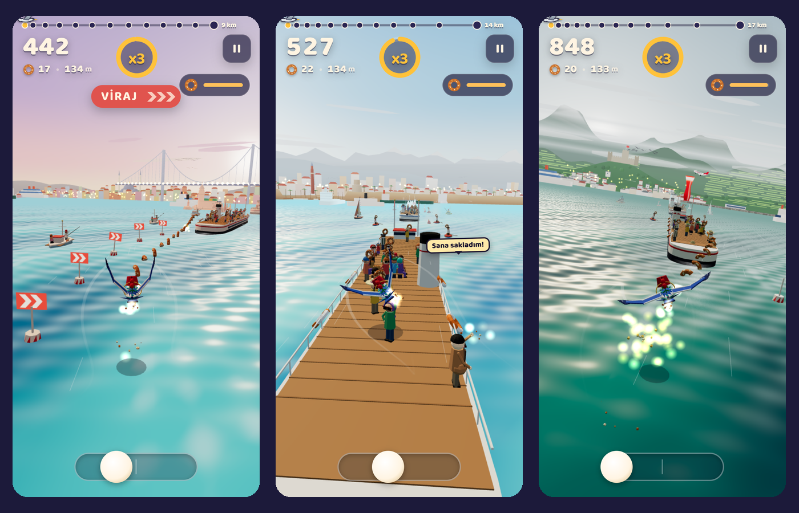

# Simit Martısı

A one-finger 3D endless flyer for phones and desktop browsers.
You are an Istanbul seagull gliding over ferries at sunset, snatching *simit* from passengers' hands
while dodging funnels, flag masts, kites and rival gulls.

**Play:** https://ardazeybek-dev.github.io/simit-martisi/ (installable, works offline after the first visit)



## Controls

| Device | Steer | Other |
|---|---|---|
| Phone | Drag anywhere left / right: the gull moves by how far you drag, never jumps to where you touch, and stays put when you let go; dragging about two thirds of the screen width takes the gull from one rail to the other, pushing past the edge is not counted so turning back starts at once, a second finger never steals the steering, and the slider knob at the bottom shows where you are steering | Pause button top right |
| Desktop | Move the mouse, or ← → / A D | `P` / `Esc` pause, `M` sound on/off, `Space` start |

The game pauses itself when the tab or app goes to the background and resumes with a 3-2-1 countdown.

## Gameplay

- **Goal: fly the Bosphorus line.** Every flight leaves Kadıköy and heads up the strait: Karaköy (400 m), Beşiktaş, Ortaköy, Arnavutköy, Bebek, Rumeli Hisarı, Emirgan, İstinye, Yeniköy, Tarabya, Sarıyer and the Black Sea (9,300 m; İzmir 12 piers to 12 km, Antalya 12 piers to 15 km). The HUD shows the next pier and the metres left; a pier is a gate with its name board, the terminal on the bank and a simit line ending in a golden simit right under the sign. Flying under the sign triggers a short slow-motion moment with fireworks, then the crowd on the pier throws a shower of simit pieces into the lane; arriving pays bonus points and the flight goes on to the next pier. The first time you reach a pier it pays simits (25 up to 750) and lights up on the title-screen route map; the game-over screen tells you how far the next pier was.
- **Difficulty steps:** at 5, 10 and 15 km the flight steps up clearly (eased over 300 m, with the gear-up effect): about 4.5% more speed per step and denser hazards (`TIER_M`, `TIER_SPD`). Speed reads about 44 at 5.6 km, 51 at 10.6 km and 59 at 15.6 km; 20 km is meant to be just short of impossible. Chimney spacing follows the speed and `tests/passable.cjs` stays clean.
- **Power-ups are rare:** about one open stretch in five carries one, none in the first few stretches; the shield lasts 7 s (was 11), never shows in the first 1.5 km and has a single share in the pool.
- **Last three piers:** the stretch to each city's last three piers (İstanbul Tarabya → Karadeniz, İzmir Alaybey → Bostanlı, Antalya Düden → Kundu) gets harder step by step (`endB` 1 → 3): about 2% faster per step (6% at the last pier; chimney spacing follows the speed, so it stays passable), more red and blue rivals, glass salons and convoys more often, now and then an extra rival or kite. Open water there is already full (about a third of rivals do not fit the spacing rule), so the felt change is speed and rival type, not count. 500 m past the last pier it is back to normal; daily flights are left out.
- **İzmir talk:** in İzmir a simit is a *gevrek*, so in Turkish the passengers there shout *Gevreğim gitti!* (the word is swapped in their lines, suffixes included); Antalya keeps simit.
- **Cities:** fly the Bosphorus to the Black Sea and İzmir opens; finish İzmir and Antalya opens, then Muğla, Çanakkale, Trabzon, Samsun, Rize and Mersin in that order (Mersin is the last Turkish city). Pick the city with the arrows above the route map on the title screen. Scores are multiplied by the city's `mult` (İstanbul ×1, İzmir ×1.1, Antalya ×1.2, Muğla ×1.3, Çanakkale ×1.4, Trabzon ×1.5, Samsun ×1.6, Rize ×1.7, Mersin ×1.8; the daily flight ×1). Each city keeps its own pier progress and first-arrival gifts; the wallet, outfits, missions and leaderboard are shared. Each newly opened city is harder than the one before: the first 500 m are the same everywhere; after that the gull flies 8% faster per city step up to Çanakkale and half a step more for Trabzon and Samsun and a full step again for Rize (`CITY_SPD`, `cityIdx`, ramping in from 0.5 to 4 km, full to 8 km, gone by 14 km so the late game is unchanged) while gaps are still sized from base speed, and `cityG` adds rivals (also inside imbat, race, balloon, flamingo and beach pieces), shorter open water and more convoys. `hard` in `cities.js` still shapes `heat`/`late`. Measure with the hazards-per-second count over 2–8 km (İstanbul 1.86, İzmir 1.99, Antalya 2.14, leaving out İstanbul's bridge fishing lines; with them İstanbul is level with İzmir and the speed step carries the order), not with `tests/passable.cjs`: static obstacles stay passable even at very low steering speed, so it only guards against impossible spots. Reaching a city's last pier for the first time says *Tebrikler! İzmir açıldı!* (or Antalya) on the pier card and on the game-over screen, and the title screen comes back with the new city picked. Progress is saved as a pier index: when piers are added, list the old names in the city's `was` and bump the one-time migration key (`simit-martisi-route-v2`) so stored indices move by name; keep each city's last pier name, or finished players lose the next city.
  - *İzmir:* Üçkuyular to Bostanlı (10,000 m) past Göztepe, Konak, Pasaport, Alsancak, Bayraklı and Karşıyaka, under an Aegean afternoon sky with the Konak clock tower, Kadifekale and the Bayraklı towers on the horizon. You catch gevrek instead of simit (same value). There is no bridge; instead the *imbat* blows: white wind streaks sliding across the water mark a gust lane that pushes the gull downwind while gevreks tumble across it, so leaning with the wind catches them. Three more things of its own:
    - *Kordon balloons:* a balloon seller on a Kordon quay (stone edge, railing, street lamps) lets a bunch go; every balloon carries a gevrek on its string and floats into the lane so the gevrek is at the gull's height right as it arrives. Catching the gevrek pops the balloon; too late and it rises away with it. Popping the whole bunch pays a bonus (20 points).
    - *Sailing race:* a row of small Optimist-style dinghies stands in the lane, each with its square sail swung out to one side (the sail is the hazard, `REGATTA_BOX`); the gevrek line slaloms past the open side. Gaps follow the speed (0.7 s). Catch three quarters of the line for a finish bonus (25 points). The orange marks show start and finish.
    - *Flamingos (Kuş Cenneti):* a pink flock stands on mud shoals across the lane and takes off as you arrive, fleeing outward and up. Passing one at your height pays a small bonus (5 points) and refreshes the combo timer; they never hurt you.
    Order of first appearance: imbat after about 450 m, balloons about 800 m, the race about 1.7 km, flamingos about 2.6 km.
  - *Antalya:* Konyaaltı to Kundu (12,500 m) past Kaleiçi, Mermerli, Karaalioğlu, Falez, Lara and Düden, on turquoise water under the snowy Taurus Mountains, with the cliffs, the Yivli Minare and Hıdırlık Tower on the horizon. Four things of its own:
    - *Pirate boat:* a black-sailed tourist gulet slowly crosses the lane. Its masts, sails and tall stern castle are hazards; the gap between the two sails is the way through, and the two tourists on deck each throw a golden simit right into it (pirates are rich: gold only, two per boat).
    - *Düden falls:* a waterfall pours off a cliff beside the lane and its spray drifts over that half. Fly into the spray and the gull is lifted up and pushed away from the falls; a high arc of simits with a golden one on top can only be reached by entering the spray at its start.
    - *Beach umbrellas:* a sand spit with straw umbrellas and sunbeds runs beside the lane. Tourists under red, blue and green umbrellas throw pieces in pairs, each ring on the water in its umbrella's colour; catch the same colour pair after pair for a growing streak bonus (two pairs in a row always share a colour, but you have to look ahead to keep it going).
    - *Parasailing boat:* off Lara a speedboat crosses the lane towing a parachute high above. The tow rope (dark, with orange pennants) passes the gull's height at one point, and that point is the hazard (*Paraşüt ipine takıldın!*); it slides with the boat but is always at the same place when you arrive. The tourist hanging under the chute throws simit pieces on the side the rope is leaving. First one after about 1.4 km.
  - *Muğla (Bodrum peninsula):* Bodrum to Gümbet (15,500 m) past Torba, Türkbükü, Yalıkavak, Gümüşlük and Turgutreis. Windmill islets with gusty imbat (`?degirmen`), a gulet gate (`?gulet`), a dive boat whose bubbles lift the gull (`?dalgic`), and Bodrum Cup wooden yachts (`?bodrumcup`).
  - *Çanakkale:* Lapseki to Truva (16,000 m) along the Dardanelles. The 1915 bridge with red towers (`?kopru1915`, twice per route), the wooden horse gate with gold under its belly (`?truva`), a current that flips at a whirlpool (`?akinti`), and a ferry gate (`?feribot`).
  - *Trabzon:* Akçaabat to Sürmene (16,500 m) under green Black Sea slopes. Leaping anchovy shoals (`?hamsi`, small hunger refill), a breaking wave gate (`?dalga`), the Boztepe cable car rope (`?teleferik`), and a horon boat colour chain (`?horon`).
  - *Samsun:* Bafra to Terme (17,000 m) past the Kızılırmak delta, Atakum and Amisos. The river-mouth push (`?irmak`), the Bandırma steamer gate (`?bandirma`), delta storks and herons (`?delta`), and a harbour crane cable (`?vinc`).
  - *Rize:* İyidere to Fındıklı (17,500 m) under misty, tea-terraced slopes, mostly rain and fog. The tea barge gate (`?mavna`: sack stacks and wheelhouse are hazards, two tea workers throw into the deck gap, the low stack can be flown over), the jet blast of a plane on the sea-fill runway (`?ucak`: it spools up with glowing engines and streaks, pushes the gull across, then takes off ahead; piers, the tower, barges and simit boats keep off the runway's side), and the tea-glass tower (`?kule`): a light ring climbs the LED glass before each of two steam bursts, and only a gull on the tower's half at the burst is lifted to the high simit arc with a gold on the second.
  - *Mersin:* Mersin harbour to Kızkalesi (18,000 m) past Soli and Erdemli, hot and mostly clear. Falling Soli columns (`?sutun`: a colonnade lines both sides; some columns shake and shed dust, then topple across the lane timed to the gull's arrival, so the column always crosses the gull's height at the same spot; the hit box follows the angle; the column falls slowly and is still 30–45° from upright when the gull arrives, so the crossing point creeps and the safe way is the side away from the falling column, under its leaning shaft, where the simit line runs (one hides a gold), and a column lying in the water is no longer a hazard), the Kızkalesi sea castle (`?kizkalesi`: in through the front arch, slide across the courtyard, out of the offset back arch; gold in the courtyard, bonus for passing; the wall between camera and gull fades), and a citrus boat colour chain (`?narenciye`: orange, lemon and mandarin crate stacks and workers, each thrown piece wears a rind ring of its colour).
  Measured hazards per second over 2–8 km (boxes taller than the gull's flight height, boxes closer than 3 units counted once, plus rivals and kites, over the flight time from the speed curve; 5 routes per city, all counted the same day): İstanbul 1.59, İzmir 1.60, Antalya 1.66, Muğla 1.84, Çanakkale 1.90, Trabzon 1.97, Samsun 2.03, Rize 2.11, Mersin 2.18. Hazard counts are about the same everywhere (open water is already full), so each new city gains through speed.
- **Score** = simit points + 1 point per 10 m flown.
- **Lane and hit boxes:** the lane is as wide as a ferry and the gull stays inside the rails, so a glass salon can only be passed through its middle passage and steering is quick, so a late dodge still works. Hazards hit only when you really touch them; rival gulls are clearly smaller than yours. Simits and power-up bubbles are picked up from a generous distance around the gull.
- **Combo:** catch simits in a row to raise the multiplier; the HUD shows x2 at 15, x3 at 36, x4 at 65, x5 at 100 simits in a row (`COMBO_STEPS`), while the points multiplier is lower (x1.25, x1.5, x2, x2.5: `COMBO_MULT`); a miss or an empty ring drops one step instead of resetting, so the combo rides up and down between x2 and x4. The chain dies when you let a simit in your own path pass (simits in another lane do not count), a thrown piece drop into the sea, or go about 2.5 s without a catch; simits held by passengers do not count as missed. The ring in the HUD shows how long it stays alive. From the first step (x1.5) on, thin trails stream from the gull's wing tips, growing a little stronger and turning a soft cream gold toward x4 (white on the golden gull); they fade as the chain is about to die, so you can tell without looking at the HUD.
- **Simit boats:** on open water, simit sellers in rowboats on both banks break their simits and toss the pieces to you. Each piece is a quarter simit (a quarter of the points and of the wallet value); some throwers toss a single piece, others up to four; it arcs over and comes down right as you get there, with no mark on the water beforehand (only the beach shows coloured rings for its colour streak); miss it and it splashes into the sea. On ferries and at piers the thrower is often the simit seller himself, next to his glass-cased cart or his tray with a simit pole: the simits on display are scenery and can't be eaten, only the pieces he throws can.
- **Ferries:** three kinds share the lane width: the classic line ferry (44-58 m, round stern, red band), the short motor ferry (34-38 m, square stern, portholes, blue band, low raked funnel, never a glass salon) and the big ferry (60-64 m, two rows of windows, gold line, bridge wings, lifeboats hanging outside the rails, a wide funnel). Each funnel's hit box matches its shape.
- **Golden simit:** rare (only every other turn has one at its apex; the pier gate and the waterfall top always do), worth 5x a normal one; it glints like a star from far away, so you can line up for it early. Golden pieces are never thrown by the simit sellers: they hang still at their catch point and spin and shine in place.
- **Dolphins:** on open water a pod shows its fins, then leaps across the lane one after another as you arrive. Fly over a dolphin while it is in the air (within about 2.4 m sideways; the crossing is checked even if a frame skips past it) for a *Dolphin!* bonus that also refreshes your combo timer. They never hurt you.
- **Near miss:** brushing past a funnel or mast gives a small bonus.
- **Turns:** the Bosphorus bends every 15-25 seconds, sometimes in an S. Red chevron boards and a *VİRAJ* sign warn you first. Inside a turn the wind pushes the gull outward, so lean toward the inside: the simits trace the racing line with a golden one at the apex. Catch most of the line for a *Perfect turn* bonus and a slingshot burst of speed.
- **Power-ups** (floating bubbles): Magnet pulls simits (even out of passengers' hands), Shield absorbs one hit, 2x doubles all points.
  Upgrade them with simits in the *Güçlendir* panel: five levels each (600 up to 9,000 simits a level), every level adds a quarter of the base time.
- **Hazards:** funnels, flag masts, kites, rival gulls. A stretch of open water with a crossing sailboat has no rivals or kites, and elsewhere rivals and kites are at least 13 m apart, so there is always a way through. Turns are short (48-70 m) and from the second difficulty step on carry a rival or kite 2.6 m off the simit line; every pier after the first has a welcome party in its simit rain (a rival, then a kite, more in later districts). Dark funnel smoke makes the gull cough and blurs the edges of the screen for a moment; it does not break your combo.
  - Hazards stay sparse early on: rival gulls come one at a time from about 200 m, red ones after Karaköy, blue ones after Beşiktaş; the first Galata Bridge comes after Karaköy.
  - Rival colour tells you how it flies: *grey* glides side to side, *red* dives straight at you from further out, *blue* zigzags at random.
- **Passengers:** big-headed, round-eyed and rosy-cheeked; uncles, grandpas, aunties, young women and lads, each with their own outfit; snatch a simit and they get angry. The decks are kept sparse: most of the few who stand hold a simit (snatch it, they get angry); a handful sit on benches looking out to sea with a glass of tea and no simit. A *feeder* at the rail holds a simit out for you: take it and they cheer and pay a bonus. On some ferries a passenger at the rail breaks their simit and throws the pieces into the air over the deck, like the simit boats do; a ring on the deck marks where each piece comes down.
- **Galata Bridge:** every 1-1.5 km the lane passes under the bridge. Anglers on both rails dangle their lines down to the water at uneven gaps (a red float marks each one); thread between them, front row then back row, following the simits. Touch a line and you are hooked. Clear both rows for an *Under the bridge!* bonus.
- **Deck props:** when you come near a green rubbish bin its lid pops and a simit piece jumps up to your height; crates with a cat that hisses as you pass; rope coils.
- **Glass salon ferries:** further on, some ferries carry a closed two-storey glass salon. Fly through the open passage in the middle and collect the simits inside; the glass on either side is solid.
- **Weather follows the real calendar** (picked again every flight): snow in winter, mostly rain in autumn, now and then fog, mostly clear in spring and summer.
  - *Rain:* lightning, and gusts of wind shove the gull sideways; steer against them.
  - *Hunger (any weather but snow):* a fullness bar (simit icon) stays on screen the whole flight and drains after the first 50 m. With no simits it runs out in 7 s (İzmir 6.5 s, Antalya 6 s, then `hunger` in `cities.js` down to Samsun 4.8 s); a simit refills 25%, a golden one 60% (a thrown piece half that), so you have to keep catching. In the last quarter the gull shivers and its head droops; when it runs out the gull falls (*Açlıktan düştün!*), and a shield only buys a little time. The longest gap between simits on the route is about 2-3 s.
  - *Snow:* a warmth meter drains while you fly. Simits warm you up (a golden one a lot); it stays on screen the whole flight and with no simits runs out in 8 s, shivering for the last 2 s (a simit warms 25%, a golden one 60%). When it runs out the gull freezes and falls (*Donup düştün!*). It starts draining after the first 50 m.
  - *Fog:* the view shortens, hazards appear late, ferry horns sound through the mist.
- **Speeding up:** the further you fly, the faster it gets: steep in the first minute, then creeping up to a top speed. On top of that, tempo stretches planned by distance (the same for everyone in the daily flight): *calm water* (about 13% slower, no rivals or kites, a simit rain or two dolphin pods) and *tailwind* (about 14% faster, heavy speed lines, a whoosh on entry); the speed eases in over about 2.5 s so thrown simits still land on time.
- **Varied route:** open water and ferries no longer strictly alternate: sometimes two ferries come as a convoy (a short simit-only gap between them), sometimes two stretches of open water in a row. Each stretch of open water is one kind, never the same special kind twice in a row: mixed, simit rain, dolphin pods, a rival flock or a kite row. After about 1.6 km the lane does not get more crowded but smarter: more red and blue rivals, red ones dive a little faster, open water gets shorter; rivals start moving earlier at high speed so there is still time to react.
- **Second chance:** spend fish to keep flying from where you crashed, with a shield and a 3-2-1 countdown. Each revive in the same flight costs twice the last one (1, 2, 4... fish); the button shows up once you own a fish. On the portal build a rewarded ad also gives one revive per flight after a good run (250+ points and at least 40% of your best).
- **Simit wallet:** ten simits you catch (or 40 thrown pieces) put one simit in the wallet, and every 100 m flown adds one more (a golden one counts as 4 caught); the remainder carries over to the next flight (shown as *sonraki n/10* on the game-over screen), so outfits (200 to 5,000) and power-up levels (600 to 9,000) take a while to earn; the game-over screen counts up, in one number, every simit this flight put in the wallet (a new best pays the flight's simits once more, counted in the same number). A new best (from the second flight on; not in daily flights) does not interrupt the game-over card, so a second chance with fish comes first; when the flight really ends (*Tekrar uç*, *Ana menü* or the key) a full-screen record scene opens: on a sunset sky with a giant golden simit turning behind it and simit pieces drifting by, the gull (in its outfit) glides in, loops and barrel-rolls, under a red ribbon *Yeni rekor!* and the score, and a tap goes on to where the player was heading (the whole tap is swallowed, so it never starts a flight from the title). Locally `?rekor` shows it after every flight without touching the saved best. On the title screen the wallet is shortened from 100,000 (1,2 Mn) so the record sits in the middle on phones. Spend them on outfits in the *Kostümler* panel: fez, beanie, captain hat, golden crown, simit seller's tray, chef hat, giant top hat, simit crown, sunglasses, heart glasses, giant glasses, scarf, bow tie, evil-eye bead, moustache, baby pacifier, and pink, mint, night, sunset, ice or golden feathers, the courier gull (green, helmet, delivery bag on the back; mission rewards +15%), the taxi gull (yellow with checker stripes and a roof light; close-call points x2), or the dürüm gull (wrapped in lavash with lettuce wings, meat, tomato and lemon at the front and sauce on the back). The gull stands on a wooden pier post against a Bosphorus sunset and turns slowly; drag anywhere outside the panel to spin it by hand. Every outfit has a small perk (marked ★, shown when tapped; only a worn, owned item counts, a preview does not), listed in `PERKS` in `main.js`. Three outfits are never sold and come only from *Martı Yolu*: the fisher hat (level 5, fish catch +10%), the life ring (15, hunger 20% slower) and the pirate hat (25, golden simits +1 to the wallet). Tapping an item previews it on the gull; a separate button buys, wears or takes it off. Right under the gull (placed from its on-screen position, on the podium) three large glass boxes (*Kıyafet*, *Deri*, *Şapka*) show what is worn in each tab: tap a worn item's × to take it off, tap a box to open that tab. Head, eyes, neck, face and feathers each take one item. The panel has three tabs: *Kıyafet* (eyes, neck, face), *Deri* (feathers) and *Şapka* (head). Every day one outfit you do not own is 20% off (*deal of the day*), picked from the date alone so it stays the same all day and changes at midnight; there are no other discounts. Outfits are drawn oversized, and the feather outfits add their own back and tail pieces (ice crystals and icicles, golden spikes and plumes, a crescent and stars, a flamingo tail fan, mint leaves, a sunset tail) so they read from the chase camera behind the gull. The game-over screen shows how many points you were short of your record and a bar toward the cheapest outfit you do not own yet.
- **Outfit perks:** one item per slot (hat, eyes, neck, face, skin), and items from different slots are worn together, so their perks stack. Every outfit has a small perk (★ in the panel): hats — fez simit points +5%, beanie colds 20% slower in snow, chef tea break +15%, captain magnet +15%, top hat all power-ups +10%, tray mission rewards +10%, golden crown golden simits +20%, simit crown catch reach +8%; eyes — sunglasses shield +15%, heart glasses combo timer +10%, giant glasses near-miss zone 20% wider; face — moustache close-call points +25% (not stacked with the taxi), pacifier shield after a revive +25%; neck — scarf colds 40% slower, bow tie dolphin bonus +50%, evil-eye bead one more shield in the power-up pool; skins — pink simit points +5%, night rain wind pushes 20% less, mint no cough from funnel smoke, sunset distance pays 15% more simits, ice colds 50% slower in snow, dürüm hunger 30% slower, golden wallet +10%, courier mission rewards +15%, taxi close-call points x2. Score perks stay small on purpose: the leaderboard must not be bought.
- **Power-ups** show on about a third of open-water stretches, never the same kind twice in a row.
- **Fish:** the second currency. Fish are rare: at most one fish per flight, never in the first 700 m, and only now and then (`fishSpawn` 12% per stretch of open water, +5% for every stretch that passed without one, so long flights almost always get a chance) does one splash on open water and leap up to the gull's height as you arrive. Touch it and you may catch it (`fishCatch` 75%: a fish for the wallet, a small bonus, a fresh combo timer and a *Balık!* bubble) or it slips away (*Kaçtı!*). At most 2 fish a day from flights (a first revive costs 1 fish, a second one in the same flight 2 more, so a double revive takes saving up): the count is kept on the server per player id and Istanbul day (RPC `fish_day`), with a local fallback offline. Fish pay for revives; the 7th day of the daily reward streak also gives one.
- **Leaving a flight:** a flight is saved every 10 s and whenever the page is hidden or closed (score as pending for the leaderboard, simits banked, record, achievement counters and missions), so a reload or crash loses nothing. *Ana menü* in the pause menu ends the flight on the game-over screen (*Uçuş bitti*), so the score still reaches the leaderboard and the simits the wallet; if the page is hidden, reloaded or closed mid-flight, the score so far is kept as pending and sent on the next launch (the run ticket is valid for a day).
- **Title screen:** tapping outside an open panel closes it (it never starts a flight). The wallet and record sit on top, the side buttons open outfits, missions, rewards, achievements, the board and power-ups; the bottom row is a mode button (Classic or Daily flight, picked from a card list where later modes go) next to Play, which starts the picked mode. The name lives in Settings → Profile; the gull level chip sits under the wallet and fish. Outfits are tried on a lit podium where the gull turns in place instead of over the water.
- **Daily flight (picked with the mode button):** every day everyone flies the same İstanbul route with one rule of the day, picked from the date: *Golden hour* (golden simits twice as often, one at every turn's apex), *Fast ferries* (15% faster), *Chubby gull* (a fat-bodied, bigger gull that steers sluggishly but grabs simits from further away; obstacles hit a little sooner), *Giant simits* (simits twice the size, each counting as two) or *Hiccuping gull* (every 2-4.5 s the gull hiccups: it hops sideways and puffs up for a moment). Try one with `?rule=gold|fast|chubby|giant|hiccup`. Three tries a day (`DAY_RUNS`): a try is used on take-off, so quitting mid-flight still counts, while a second chance does not; the mode button shows the tries left and Play greys out when they are gone. The route is seeded from the date: world generation reseeds for every segment and every turn (`seedAt` in `main.js`), so a segment changed by the player (rivals sent to a camped edge) does not shift the ones after it. The rule shows once on the take-off card. Daily flights keep their own best for the day and a day streak; the first finished daily flight each day pays 15 simits, growing by 5 a day up to 45. They do not touch your record or friend challenges (the share link carries no challenge), but they count for the weekly leaderboard like any flight.
- **Gull rank:** every flight turns into XP at the end (1 per simit caught, 1 per 20 m; nothing ticks during the flight). Level *n* needs 150 + 25·*n*² XP (rounded to 10): 180 for level 2, about 10,000 around level 20, about a million in total from level 1 to 50. Titles change at levels 1, 3, 6, 10, 15, 20, 30, 40 and 50 (Gull chick, Ferry gull, Simit hunter, Bosphorus wolf, Pier boss, Captain gull, Legendary gull, Gull king, Simit sultan). Settings → Profile shows the level and opens *Martı Yolu* (the gull road), where every level's prize is claimed by hand: 10 + 3·*n* simits, plus *n*/10 fish at 10, 20, 30…, the road-only fisher hat, life ring and pirate hat at 5, 15, 25 (never sold), and a chest of 50 + 20·*n* simits at the other fives. A dot on the settings gear and on the profile row means a prize is waiting; passed levels can be claimed later (`rank.got`). Levels reached before the road existed are claimable too; existing levels are kept when the curve changes. The game-over screen fills the XP bar. Tune `xpNeed`, `lvGift`, `RANKS` and `ROAD_COS` in `main.js`.
- **Rewards panel (*Günlük ödül* button):** two tabs. *Daily reward* grows with the login streak (10 up to 80 simits, a fish on day 7); the streak keeps counting after day 7 (8, 9, 15…, shown as *🔥 N gün seri* with the cards labelled 8-14, 15-21…) while the reward cycles weekly (day n pays `DAILY[(n-1)%7]`, a fish every 7th day), so the economy is unchanged. The server stores the full count and returns it as `n`; `streak` stays 1-7 for cached old clients that read `DAILY[streak-1]`. The server keeps the claim (Supabase RPC `daily`, keyed by the player id; before the first registration by a hash of the network address and browser), so clearing the device's data does not give the reward twice or reset the streak; the day turns over at midnight Istanbul time. Without a connection the local record is used. *Lucky wheel* spins for 1 fish or 280 simits; eight slices pay 100, 150, 250, 500, 1,000 or 3,000 simits, or 1 or 3 fish. Gambling must not pay: a spin returns about 165 simits on average (about 60% of its cost), 1,000 comes up about once in 667 spins and 3,000 once in 2,000. The prize goes into the wallet as soon as you spin, so closing the panel mid-spin loses nothing. Tune it with `WHEEL`, `SPIN_FISH` and `SPIN_SIMIT` in `main.js`. The wheel also gives one free spin a day (the menu dot shows it is waiting); it only lands on 100 simits (97%) or 1 fish (3%), never on the paid wheel's big prizes (`FREE_W`). If you missed one or two days of the login streak (and it was at least on day 2), *Save the streak* buys it back for 50 simits. Locally `?seri=13` sets yesterday as day 13 and `?kopuk=9` a 9-day streak broken two days ago.
- **Challenge a friend:** the share button on the game-over screen sends a link carrying your score and distance (on phones together with a 1080x1080 picture of the flight). Whoever opens it sees *A friend scored N* on the title screen, and in that city a blue flag buoy with your score floats beside the lane at the metre where you crashed; flying past it pays a small bonus. The game-over screen tells them how many points are missing or that they won, and the button turns into *Ask for a rematch*. A challenge stays until it is beaten; a new link replaces it.
- **Record buoy:** a golden flag buoy marks your longest flight so far (from 150 m on); passing it chimes.
- **Leaderboard:** two tabs. *Genel* (left) is a real, permanent table shared by every player (it never resets). *Haftalık* (right) holds each player's best of the week, which starts Sunday 00:00 UTC (`wscores`, `sm_wk()`; the first week starts 2026-11-15 and the tab says when until then); the weekly prize (`give_weekly_prizes`, pg_cron Sunday 00:00 UTC) pays by the week that just ended (the 2026-11-15 payout was the last one by the all-time table). The tab choice is kept on the device. Every flight counts from the very first one: a player with no name yet is registered as "Martı" plus four digits, and after the first flight the game asks for a gull name (2-16 characters, changeable from Settings → Profile or from the board); picking one renames the same entry. Each flight sends its score, including the part flown after a second chance; the board ranks everyone by their best score ever. The first time a device syncs, its local record (made before the board existed or offline) is sent once, capped at 30,000. The game-over screen shows your rank and how far you climbed; the board lists the top 50, your own row and how many points the player above you is ahead. Offline the game plays as usual; a flight that started online but ended offline is sent when the connection is back, a flight started offline stays off the board; "Invite friends" shares the game link.
- **Missions:** come in sets of three ("catch 45 simits in one flight", "8 close calls", "fly under the bridge twice"...). A finished mission pays simits right away; when all three are done the next set arrives once you have seen them finish in the *Görevler* panel, about 22% harder and paying about 10% more each set (capped at what one flight allows). At most three sets a day; a new day also replaces a set you got stuck on. The game-over screen stays uncluttered (no record, rank, distance-to-next-pier or next-outfit lines, and the share button just says *Paylaş*): open *Görevler* from the title screen to watch the bars fill up from where the flight started, finished missions get crossed out and their simits tick up into the wallet. The menu badge counts new missions and clears once you open the panel.
- **Daily flight is for fun:** it pays simits but moves no missions, achievements or badges (play time still counts).
- **Fun badges and play time:** One breath / Strong wings / Tour of Türkiye (1, 3, 9 cities finished in one flight without a second chance), Fasting gull (100 m without a simit, the hunger bar allows only a few seconds), Close-call master (105 in a flight), Golden rain (250 golds in a flight) and a hidden Night owl. The pause screen shows this flight's time; settings show the total (`ach.st.playSec`, real seconds, pauses not counted).
- **Achievements:** twelve long-term goals (total simits, golden simits, longest flight, best score, streak, snatched simits, close calls, perfect turns, dolphins, bridges, flights, outfits), each with bronze, silver and gold tiers paying 25 / 75 / 200 simits, claimed in the *Başarımlar* panel. Your earlier best score and furthest pier count from the start.
- **Badges:** a collection tab in the *Başarımlar* panel with 21 badges and no rewards: total distance (1 km up to 10,000 km), days in a row (3 up to 365), flights, fish, simits, finished cities, and a 500 m flight in rain, snow and fog. Newly earned badges glow and are counted on the menu button until you look; tap a badge to see how to earn it.
- **Quiet screen:** no floating score texts during a flight; bonuses, missions and power-ups land silently in the score and the wallet. Only the *VİRAJ* sign, the pier arrival card, the passengers' short speech bubbles (when you snatch their simit, at most one every couple of seconds) and *Balık!* / *Kaçtı!* when you touch a fish appear. Passengers say something different every time: about 130 lines by passenger type (uncle, grandpa, auntie, young woman, lad, child) plus shared ones, and no line repeats within a flight.
- **Languages:** 20 (Turkish, English, German, Spanish built in, 16 more in `js/lang/`). The browser language is used when supported, otherwise English; *Settings* has a drop-down listing each language by its own name.
- **Settings:** music and sound effects volume sliders, the same in the title settings and the pause menu; tapping the speaker next to a slider mutes it, tapping again puts the slider back where it was. Vibration and language (Turkish, English, German or Spanish, the browser language by default). The title screen has no separate sound button; *M* mutes on a keyboard.
- **Title screen:** the camera sits at the gull's eye level and the chosen city stands right behind it in three smooth-shaded layers (front, middle, back) that drift at different speeds with the camera's slow sway (İstanbul: Galata Tower over its hillside, a mosque, the quay with a docked ferry, the Maiden's Tower with waving visitors in front; İzmir: the Kordon palms, the clock tower, Yalı mosque, the Asansör, Kadifekale and the Bayraklı towers; Antalya: Kaleiçi harbour with gulets and a pirate boat, Konyaaltı umbrellas, the cliffs with Yivli Minare, Hıdırlık Tower and Düden falls, the snowy Taurus behind). It is hidden as soon as the flight starts.
- **World map:** the city button on the title screen (🗺️ and the city name) opens the map, which is the only place to switch cities. Turkey is a 3D island with a small diorama for each city built from the game's own models; drag to pan, pinch or use the mouse wheel or +/− to zoom, and press Esc to close. Tapping an open city or its name tag selects it. The bottom card shows the city's multiplier, its pier dots and the next goal, and *Seç* (select) closes the map back to the title screen with that city chosen; the flight starts from there. The map has no back button. A finished city flies a flag, and a stone path joins the cities in unlock order: the path turns gold where a city is finished and bends around hills. Locked cities sit under cloud and show a 🔒; the next one to unlock shows as a grey model. The first time the map shows a newly unlocked city, its cloud clears once, and until then the city button on the title screen pulses (`simit-martisi-mapseen`). When you zoom out, America, Japan and South Africa appear as cloudy islands marked *Yakında*. The map has its own scene and shares the game's renderer: `js/worldmap.js` handles the camera, input and progress layer, and `js/mapsets.js` holds the dioramas.
- **Off-lane scenery:** the flight horizon is shaded for depth, with a second skyline row behind the first and a haze band along the waterline.
- First launch shows a 3-second swipe tutorial, then a dodge lesson in the first stretch: a rival on the right, later one on the left; as each comes close the game slows down (at most ~3.5 s) and a hand swipes toward the free side until the gull is there. The first time a glass salon, a wind or current zone or a falling column row comes up, a one-off card in the pier-card spot tells what to do (seen ids in `simit-martisi-hints`). Best score, settings, wallet, outfits and missions are kept in `localStorage`.

## Tech

- Plain ES modules under `docs/`, no build step; [three.js](https://threejs.org/) 0.160 from jsDelivr via an import map
- All models are generated in code and merged into vertex-coloured meshes. Every visible mesh drawn with the shared vertex-colour or gold material is drawn through one InstancedMesh per geometry (`syncBatches` in `models.js`): the objects keep living in the scene for gameplay but sit on a camera-hidden layer, and each frame their world matrices are copied into the batches (frustum-culled, mirrored meshes excluded). A busy frame went from about 300 to about 110 draw calls, which was what made phones stutter
- Soft pastel sunset sky over clear turquoise water, custom GPU wave shader with fresnel and sun glitter (waves calm down with distance into a hazy far sea), gradient sky dome, a colourful Istanbul skyline (pastel houses with tiled roofs, cream mosques with lead domes, Galata Tower with its dark cone, Bosphorus Bridge, Maiden's Tower, green hills, ships with coloured hulls and containers) that fades into the haze with distance and in bad weather
- Off-lane scenery: ferries, container ships and tankers cruising past in the outer lanes, big cargo ships and tankers lying at anchor in the haze further out, parallel to the lane so they never poke into the shipping lanes, ship silhouettes (cargo, tanker, ferry, cruise ship) drifting along the horizon in evenly spaced rows and on the side horizons, never overlapping and only wrapping around while off screen, flocks of gulls in V formation high in the sky (one instanced mesh, never in your way), anchored fishing boats, sailboats and small yachts whose crews jump and wave as you pass, orange lifebuoys on the hulls, a big cruise ship with a jumping crowd on its top deck and terraces (instanced, a few draw calls), and every 1-2 km a close pass by the Maiden's Tower: a rocky islet with a railed terrace of waving visitors, striped umbrellas, a simit cart, a small lighthouse and a wooden jetty with a moored boat (never on the same bank as a nearby cruise ship)
- Pooled instanced particles, smoke sprites, speed lines, camera shake, hit-stop
- Music and all sound effects are synthesized with the Web Audio API, no audio files: a Hicaz tune with plucked saz strings (Karplus-Strong), kanun tremolo, a ney in the middle section and darbuka in maqsum rhythm; cymbals and fills join in as the flight speeds up
- Adaptive quality: pixel ratio steps down automatically on slow devices; turning shadows off recompiles every shader, so that switch waits for the menu or the game-over screen instead of freezing a flight. Phones start at medium quality with MSAA (cheap on tile-based phone GPUs) and without shadow maps (the gull keeps its blob shadow); their lowest pixel ratio is 1.5 so fast turns never look pixelated, and the audio uses a larger buffer, a longer scheduling window and pre-built saz strings. The audio graph is built while the title screen idles (the context starts suspended) and the first tap only resumes it; building it on that tap froze the take-off frame for about 150 ms
- PWA: web app manifest + service worker (network-first for game files, cache-first for the pinned three.js build)

## Run locally

Serve the `docs/` folder over HTTP (ES modules do not load from `file://`):

```
python serve.py
```

Then open http://localhost:8765. An internet connection is needed the first time to load three.js and the font.
`serve.py` sends `Cache-Control: no-store`; a plain `python -m http.server` sends no cache headers, so the browser can keep old modules after an edit and you test an older build without noticing. The service worker only registers on https.

`node tests/smoke.cjs` is the smoke test: it serves the game on 8765 (or uses the running server), blocks every Supabase request, opens and closes each menu panel on a 390x844 phone window, flies ~20 s on autopilot in all three cities and exits with code 1 on any page or console error, otherwise prints `SMOKE OK`. It runs headless on the GPU and muted, so no window or sound appears. It loads Playwright from the global `@playwright/cli` install (`%APPDATA%/npm/node_modules/@playwright/cli`); without it, run `npm i -g playwright` and `npx playwright install chromium`.

`node tests/costumes.cjs [shot.png]` checks that every costume has an icon, a perk with a real effect, its size entry and a name/perk translation in all 20 languages, then wears the newest pieces in the browser and flies a few seconds (optional wardrobe screenshot).

`node tests/android-notch.cjs` (emulator running, debug APK installed) turns on the emulator's tall display cutout, checks that the top buttons sit below it on the title screen and in flight, then turns the cutout off. On WebView below 140 Capacitor pads the whole view below the cutout (`env(safe-area-inset-top)` reads 0); from 140 on the inset reaches the page and the CSS `env()` padding takes over.

`node tests/passable.cjs [runs] [km] [cities]` checks that no stretch is impossible: it builds whole routes (default 3 per city, 25 km) and sweeps them with a perfect player who steers at most 17 units/s sideways, through chimneys, masts, salon glass, race dinghies, crossing sailboats and pirate boats (an obstacle of kind `yelkene` is taken for a moving crossing sailboat and skipped as a static box, so a sail that stands still needs `fix: true`) (rivals and kites move with time and are left out). It needs the game served on 8765 and exits with code 1 when it finds a stretch nobody can pass; `VLAT=0` must report failures (sanity check). Run it after changing obstacle spacing or speed.

**Test hub:** with `serve.py` running, http://localhost:8765/test (`tests/test-merkezi.html`, never published) lists every recent change with links that jump straight to it, a done / problem mark and a note per item (kept in the browser), and *Copy my notes*. Every new change gets an entry there (newest on top). `?hepsi` opens every city (wallet untouched); `?zor=0` turns off the gentle extra crowding after 2 km (heat +0.4 by 6 km) for comparison.

These test addresses work only on localhost (`QS` in `main.js`, `FORCE` in `weather.js`); on the live site they are ignored so a locked city or short route cannot be opened from a link. `?stop=0.02` puts the piers even closer than `?stop`. Append `?turn=0` to fly a straight Bosphorus without turns, `?throw=0` for the old floating simits instead of thrown ones, or `?pal=old` for the earlier deep sunset colours, `?weather=rain|snow|fog|clear` to force the weather, `?bridge` to meet the Galata Bridge right away, `?imbat`, `?balon`, `?regatta`, `?flamingo` (İzmir), `?pirate`, `?duden`, `?beach` or `?parasut` (Antalya), or the Muğla/Çanakkale/Trabzon/Samsun flags listed under *Cities*, to meet that city feature right away (with `&city=izmir` or `&city=antalya`), `?salon` to give every ferry a glass salon, `?stop` to put the piers very close together (handy for comparing), `?at=20000` to start at that metre (every retry too) and `?go` to skip the title and fly at once, `?tut` to replay the tutorial, the dodge lesson and every new-mechanic card (nothing is saved for the hint cards), `?rule=gold|wind|fog|fast|fish` to force the daily flight's rule of the day.

Append `?q=0`, `?q=1` or `?q=2` to the URL to lock the quality level (low / medium / high) and turn off automatic adjustment.

No environment variables are needed: the leaderboard backend address and its publishable key sit in `docs/js/net.js` (`SB_URL`, `SB_KEY`).

## Leaderboard backend (Supabase)

A free Supabase project holds the tables `players`, `scores`, `runs` and `transfers` (move codes) among others. All are closed to the client (RLS on, no policies, privileges revoked); the game only calls these `security definer` functions over `POST /rest/v1/rpc/<name>` with the publishable key:

| function | does |
|---|---|
| `register(p_name, p_cc)` | creates a player, returns `{ id, secret, name }` (kept in localStorage `simit-martisi-profile`) |
| `rename(p_id, p_secret, p_name)` | changes the name |
| `set_cc(p_id, p_secret, p_cc)` | changes the country (flag), picked in the profile from the drawn flags in `board.js` (`COUNTRIES`) |
| `start_run(p_id, p_secret)` | called when a flight starts, returns a run id (one per 2 s per player) |
| `submit_score(p_id, p_secret, p_run, p_score, p_dist, p_city)` | keeps the best (stored per week), returns the all-time rank |
| `claim_best(p_id, p_secret, p_score)` | once per player created before 2 Nov 2026: stores the device record (≤ 12,000) |
| `run_mark(p_id, p_secret, p_run, p_dist)` | flight checkpoint every 400 m: at most 40·Δt + 40 m since the last one, ignored if under 10 s apart; `submit_score` rejects more than 1,500 m (or over 40 m/s) past the last checkpoint |
| `claim_gifts2(p_id, p_secret)` | once per page load: returns `{simit, fish, notes}` of the player's unclaimed gifts (weekly prize notes `week:N`) and marks them claimed; the game keeps them waiting on the device and opens a collection screen on the menu, *Topla* adds them to the wallet (`claim_gifts` stays for old clients) |
| `transfer_make(p_id, p_secret, p_data)` | *Profile → Move your account to another device*: stores a raw copy of the device's `simit-martisi*` keys (not the profile, pending score, unclaimed gifts, settings or reset marks) under an 8-character code, valid 15 minutes, single use |
| `transfer_claim(p_code, p_old_id, p_old_secret)` | returns `{ id, secret, name, cc, data }` and deletes the code; the new device replaces its progress with `data`, takes over the id and reloads. Rejected ('device has score') if the new device already has a score, so the board never gets a second line; the game only offers code entry on a device with no record, and only the code button on one that has flown |
| `delete_player(p_id, p_secret)` | *Profile → Delete my account* (required by both stores): deletes the player row; scores, weekly scores, runs, gifts and transfer codes go with it by cascade, plus the daily streak key. Returns `false` for an unknown id/secret (the client then clears its local profile anyway); any other error leaves the local profile in place |
| `get_board(p_id)` | `{ total, top[500], me }` ranked by each player's best ever (`week`, `ends`, `prev` stay null for old clients) |

On `localhost` the game never talks to the server (no player, scores or board), so local test sessions cannot add fake players; append `?net=1` to the URL to test the online parts locally.

To hide a cheater from the board without deleting the account: `update players set hidden = true where id = '<id>';`.

To give a player simits: find the id with `select id, name from players where name ilike '%name%'`, then `insert into gifts(player_id, amount) values ('<id>', 5000);` in the SQL Editor. The player gets them the next time the game opens.

Cheat and name guards (server side, so a hand-made request cannot skip them):
- A score is checked against the seconds `t` since its run started: distance ≤ 40·t + 100 m (top speed with the sling is about 29 m/s) and, after dividing the score by the city multiplier (İzmir 1.1 … Samsun 1.6; the SQL `cm` case must list every city with `mult` > 1 or its scores are rejected), score minus distance/10 ≤ 600·t + 1500 and ≤ 12·distance + 1500 (real flights top out near 6.7 points per metre). An invincible autopilot averages about 90 points/s, but the 2x power-up with a x5 combo pushes real flights past 200/s, so keep the cap well above that. A flight started offline has no run id and stays out of the board (it still counts for the local record).
- Names: 2-16 characters, and a blocklist (Turkish, English, German, Spanish) checked after folding `ı→i`, `0→o`, `@→a`, dropping non-letters and repeated letters, so `0r0spu` or `F.U.C.K` are caught; vowel-swapped and glued forms (`purna`, `pirno`, `aposiken`, `apoziken`), `g`/`q` written for `k` (`sigenler`) and vowelless `skenler` are caught too; `i` before the root keeps `Işıkım`, `İskender` allowed. The same list and folding live in `docs/js/net.js` (`BAD`, `norm`) to warn the player at once; change both together.

To set up a new project: run `supabase/schema.sql` in the SQL Editor (it can be run again after edits; existing data stays), then put the project URL and the publishable key into `docs/js/net.js`. The secret / service_role key never goes into the client or the repo.

- A function added to `schema.sql` does nothing until the file is run again in the SQL Editor: the client treats the missing-function 404 (`PGRST202`) as a rejection and keeps retrying silently (the country picker never reached the server this way) → after each schema edit, call every RPC with curl and a dummy id; `unknown player` means it exists.

- A free project that gets no requests for about a week is paused by Supabase → `.github/workflows/keepalive.yml` calls `get_board` once a day. GitHub turns scheduled workflows off after 60 days without commits; if the board ever says "No connection" for everyone, restore the project from the dashboard and re-enable the workflow.
- To remove a cheating or rude player: `delete from players where id = '...';` in the SQL Editor (their scores and runs go with it).

Day-gated rewards (free wheel spin, daily limits, missions) read the day from `nowMs()` in `net.js`: the server time from the last response's `Date` header, advanced with `performance.now()`, so moving the phone's clock does nothing. A stored day that lies in the future counts as already used (a spin taken with the clock moved ahead is taken from that day, never added).

## Portal build (CrazyGames)

`platform/build.py` writes a portal copy to `platform/crazygames/` without touching `docs/`:

```
python platform/build.py                 # platform/crazygames/
python platform/build.py --zip <out_dir> # also simit-seagull-crazygames.zip, index.html at the zip root (the portal wants the folder, not the zip)
python platform/build.py --ads           # ads on: only after CrazyGames moves the game to Full launch (Basic launch allows no ads)
python platform/covers.py <out_dir>      # 1920x1080, 800x1200 and 800x800 covers (needs Playwright)
python tests/portal-crazygames.py        # plays the portal copy: one ad break on "play again", no outside requests
```

The portal copy:
- loads three.js and the Baloo 2 font from `platform/vendor/` (portals reject absolute URLs),
- drops the service worker, manifest, social meta tags, the share button and the leaderboard (no outside requests: `net.js` gets an empty backend address, the board button is hidden),
- calls the CrazyGames SDK v3: loading and gameplay events, `happytime` on a new best, a rewarded ad for the second chance (granted only on `adFinished`; on error the player sees "No ad available"), a midgame ad on "play again" after 60 s of play (never on the title screen: no ads behind menu buttons; skipped when a second chance was just offered), audio muted during ads and when the portal asks for it.

- saves progress through the SDK Data module (`PF.storage`; `util.js` uses it instead of `localStorage`, `main.js` loads after the SDK init so the save is there; a save already in the browser is copied over once). In the submission form pick "Yes, using the Data Module", otherwise the module stays off.

Without the SDK (ad blocker, local run) every portal call is a no-op, the save stays in `localStorage` and the game plays normally.
`?pf_minplay=0` shows the ad break on the first restart, for testing.

The build patches `docs/` source by exact string match and stops with `patch '<name>': expected 1 match` when the game code changed. Update the matching line in `build.py` then.
New game features need no new patch: call portal functions as `window.PF && PF.x ? ... : fallback`, never declare `PF` or `T` in `main.js` (the build injects them), and wrap new texts in `tr()` and add them to the `EN` table in `docs/js/i18n.js` (shared by both builds; static HTML texts are translated once at load).

## Store app (Capacitor)

`app/` wraps the game as an Android and iOS app. All game files ship inside the app (three.js and the font from `platform/vendor/`), so it starts offline and never opens a browser; the leaderboard still talks to Supabase.

Needs Node 22+, JDK 21 (`JAVA_HOME`) and the Android SDK (platform 36, path in `app/android/local.properties` as `sdk.dir=C:/...` with forward slashes). iOS needs a Mac with Xcode.

```
cd app
npm install
python build.py            # docs/ -> app/www (no service worker, no CDN, adds native.js)
npx cap sync
cd android && gradlew bundleRelease   # signed .aab for Play (app/build/outputs/bundle/release)
npx cap open ios                      # on the Mac: archive and upload from Xcode
```

- `app/native.js`: Android back button (pause in flight, close the open panel, else send the app to the background) and pause when the app leaves the screen.
- Release signing reads `app/android/keystore.properties` (`storeFile`, `storePassword`, `keyAlias`, `keyPassword`); it and the `.jks` are never committed.
- Icons and splash: `app/assets/` (square, opaque 1024 icon; Android adaptive background scaled to 85% so the wing tips stay inside the mask), regenerate with `npx capacitor-assets generate --android --ios`.
- Version: `build.py` copies the game's `app-version` into `versionName` (`build.gradle`) and `package.json` and derives `versionCode` from it (3.13.0 -> 31300), so every Play upload needs a new game version. The same version goes into the iOS project (`MARKETING_VERSION`, `CURRENT_PROJECT_VERSION`).
- The app is served from `https://localhost` (iOS `capacitor://localhost`), so `build.py` replaces the localhost checks in `net.js`, `main.js` and `weather.js` with `false` in `app/www`; otherwise the app thinks it is a local test session and the leaderboard, gifts and server clock stay off. The build stops if a check changes shape or a new `location.hostname` appears.
- iOS builds are iPhone-only (`TARGETED_DEVICE_FAMILY = 1`): iPads run the iPhone app and App Store Connect asks for no iPad screenshots. The status and gesture bar areas use the game's dark background (`game_bg` in `res/values/game_colors.xml`, `SystemBars.style: DARK`).
- Vibration: the Android app has no `VIBRATE` permission of its own and iOS WebViews have no `navigator.vibrate`, so `native.js` replaces `navigator.vibrate` with `@capacitor/haptics` (iOS: light/medium/heavy impact by length; Android: the exact duration; patterns play in order). Check on the emulator with `adb shell dumpsys vibrator_manager | grep simitmartisi` after a crash (60 ms + 90 ms).
- Release builds run R8 (`minifyEnabled`, `shrinkResources`); after touching plugins install the release APK on the emulator once and check the back button and a crash vibration. iOS ships `App/PrivacyInfo.xcprivacy` (no tracking; user id, player name and scores for app functionality; UserDefaults CA92.1). `allowBackup` stays on on purpose: Android's backup brings the save and the leaderboard identity back on a new phone.
- Share: Android WebViews have no `navigator.share`, so `native.js` routes it to `@capacitor/share` (the score card PNG is written to the cache with `@capacitor/filesystem`); shared links in the app always point at the site, not `localhost`.
- In-app update (game files without a store review), self-hosted `@capgo/capacitor-updater` with no Capgo cloud or stats (`statsUrl`/`updateUrl`/`channelUrl` empty in `capacitor.config.json`). After a web release is verified: `python app/ota.py` (builds `app/www`, uploads `bundle-<version>.zip` as GitHub release `ota-<version>`, writes `docs/app-update.json`), then commit and push main. The app downloads a newer bundle on the menu and switches on the next background/launch; a bundle that never reaches the title rolls back by itself and is not downloaded again. When a release adds or changes a native plugin, raise `MIN_NATIVE` in `ota.py` to that store build's versionCode: older store apps then show an Update card that opens the store.
- Play's pre-launch robots (Firebase Test Lab, `firebase.test.lab=true`) never reach the leaderboard: native `TestLabPlugin` + a fetch guard in `native.js`.
- Emulator tests (debug APK installed, emulator started with `-dns-server 8.8.8.8`, network on: the AVD can boot with Wi-Fi and data off, then downloads fail silently — `adb shell svc wifi enable` and `adb shell svc data enable`): `node tests/android-back.cjs`, `android-share.cjs`, `android-testlab.cjs`, and `android-ota.cjs` (needs test bundles from `python app/ota.py --test 3.13.99` and `--test 3.13.100 --broken`, passed as `OTA_GOOD`/`OTA_BAD`; delete them afterwards with `gh release delete <tag> --cleanup-tag`). Jank scan on the web build: `PORT=8777 node tests/jank.cjs`.
- Privacy policy: `docs/gizlilik.html` (live at `/gizlilik.html`).
- Store listing: `app/store/listing.md` (texts in Turkish and English, data safety, content rating), `icon-512.png`, `feature-1024x500.png`, phone screenshots `phone-*.png` (1080x1920). Retake them with `serve.py 8777` running and `node app/store/shots.cjs` (clear weather, Istanbul set worn; `CITIES=`, `LANG_CODE=en-US`).

## Project structure

```
docs/
  index.html            markup, meta tags, import map
  style.css             UI (HUD, screens, animations)
  js/i18n.js            language table and translation (classic script, loads before main.js)
  js/lang/<code>.js     the other 16 languages (fr it pt nl pl ro az id vi el ru uk hi ja ko zh); only the chosen one is loaded
  js/main.js            game state, input, spawning, collisions, main loop
  js/scene.js           renderer, camera, lights, sky, per-city skyline and colours, water shader
  js/worldmap.js        world map: own scene on the shared renderer, pan/zoom, city progress layer, far islands
  js/mapsets.js         world map dioramas (one per city, built from the game's models) and island decor
  js/models.js          seagull, outfits, simit, passengers, ferry types, Maiden's Tower, simit carts, kite, power-ups
  js/fx.js              particles, sparkles, smoke, speed lines, floating texts
  js/shiplights.js      ship lights (windows, masthead, sidelights) as one weather-dependent Points draw
  js/audio.js           synthesized music and sound effects
  js/cities.js          cities: pier lines, save keys, pickup type and city-only features (bridges, imbat, pirate boat, falls, beach)
  js/board.js           flags, local weekly best
  js/net.js             leaderboard client: name, score submit, board fetch (Supabase RPC, 5 s timeout, offline-safe)
  js/util.js            helpers, mesh merging, safe localStorage
  sw.js                 service worker (bump VERSION on every release)
  manifest.webmanifest  PWA manifest
  icons/                app icons (SVG source + rendered PNGs)
  og.png, preview.png   social preview and README image
serve.py                no-cache local server for docs/
supabase/schema.sql     leaderboard tables, RPC functions, cheat and name guards
.github/workflows/      keepalive.yml: daily request so the free Supabase project is not paused
platform/
  build.py              portal copy of docs/ (see above)
  covers.py             cover images rendered from the title scene
  src/platform.js       portal adapter: SDK calls, ad breaks
  vendor/               three.module.min.js r160, Baloo 2 woff2 + OFL licence
```

## Pitfalls

- `renderer.info.memory.geometries` keeps climbing during long runs when spawns build new geometry/materials (removing from the scene does not free GPU buffers) → cache them per variant (ferry type and length, gull type, passenger look, decor per city bait) and reuse. Cache builders that draw random numbers only on a miss shift a seeded route (the daily flight differed between the first and later flights) → builders run on the native RNG (`pureCall` in `models.js`). Parking far groups with `matrixWorldAutoUpdate = false` does nothing while the scene auto-updates its own matrix (that forces every child) → `scene.matrixAutoUpdate = false`. A set piece longer than ~75 units runs into the next turn, because the generator only sees a turn 75 units ahead (the Rize tower's steam arcs and Mersin's colonnade landed inside turns) → start long pieces with `turnAhead(len)` and lay open water first.
- Script order breaks loading: a `<link rel="modulepreload">` before the import map makes Firefox ignore the map ("bare specifier" error), and the CrazyGames SDK initialised from `<head>` throws `Cannot read properties of null (reading 'appendChild')` → import map first, SDK and adapter at the end of `<body>`; paths must stay relative (`./`, `sw.js`, `icons/...`) since Pages serves from `/simit-martisi/`.
- Geometry and colour traps: touching `ShapeGeometry` pieces on far scenery (a snow cap on a ridge) never draw → earcut can't triangulate zero-area edges, so build those quads as plain `BufferGeometry`; a top-level geometry in `models.js` that colours with `vert`/`mixHex`/`fbm` throws on load (they are `const`s defined at the end of the file) → build it lazily (`shoalGeo()`, `chuteGeo()`); merged geometry coloured per triangle by height gives zebra stripes on tall faces → build each colour band as its own extrusion; a colour mixed in by hand after `fog_fragment` in a ShaderMaterial comes out dark and salmon (it is linear, the output is sRGB) → wrap it in `linearToOutputTexel`. Ship models point their bows different ways (ferry −z, cargo and tanker +z; an extruded shape turned with `rotateX(-π/2)` puts shape y=−L/2 at z=+L/2) → set a moving ship's heading per model, or it sails stern first.
- Headless browsers render WebGL with SwiftShader at a low frame rate (gameplay in slow motion), and a headed test window that sits behind other windows or is minimised is throttled to ~1 frame/s (the smoke test then stalls in `dead`) → run headless on the GPU (`--use-angle=d3d11 --enable-gpu --ignore-gpu-blocklist`) and `--mute-audio`; Playwright WebKit on Windows also stops showing the canvas after any canvas resize → test WebKit with `?q=1`. A sideways finger drag inside a scrollable `.modal` fires `pointercancel` (`touch-action` resets at scroll containers) → give such a modal `touch-action: none` and test drags with CDP `Input.dispatchTouchEvent`. Playwright `fill()` in a mobile-emulated context can cut the text at a `-` (`beforeinput` carries all of it, `input` only part) → type codes with `pressSequentially`.
- Shader traps: bending the world in eye space with a downward-pitched camera lifts far water above the skyline in turns → bend in world axes (`uLevel` = full camera rotation, lateral origin the lane centre via `uBend2.w`); a frame that keeps the camera's yaw makes long far ships stretch and shrink with every steer; toggling shadows recompiles every material (seconds of freeze on phones) → never toggle mid-flight; a full-screen white DOM overlay animated over the canvas stutters phones on every flash → flash the scene through `renderer.toneMappingExposure` (one uniform, no recompile); `sin()` of world coordinates in the thousands turns the water grainy on phone GPUs far along the route → feed local coordinates (`uOrigin`) and phases wrapped to 2π on the CPU. A transparent `DoubleSide` material is drawn in two passes that each set `needsUpdate`, so three.js re-picks its shader every frame → give it `forceSinglePass: true`. Points or meshes drawn with your own `ShaderMaterial`, or with any built-in material set to `fog: false` (the gold-simit sparkles), float off their ships in turns, because the world bend lives in `project_vertex` behind `USE_FOG` → set `fog: true`, merge `UniformsLib.fog` and use `#include <project_vertex>`. A material with its own `onBeforeCompile` (gold simit) replaces the shared hook that binds `uBend`/`uLevel`, so it stays straight in turns and pops up on the horizon off the course → call `THREE.Material.prototype.onBeforeCompile.call(this, sh)` first.
